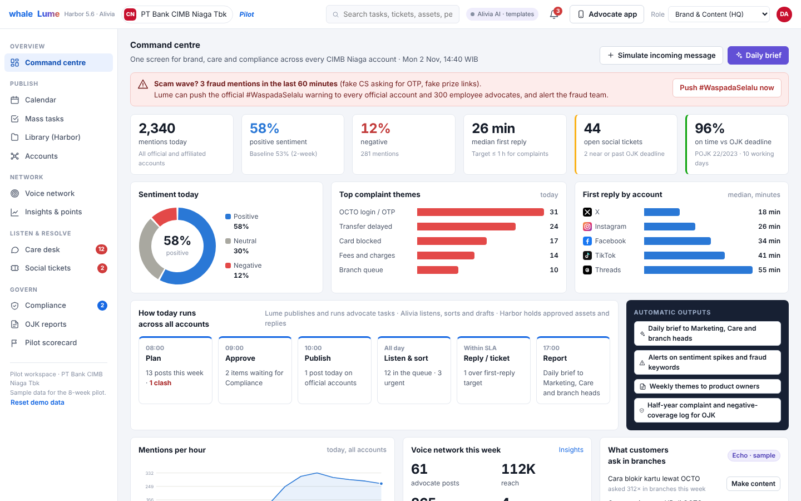
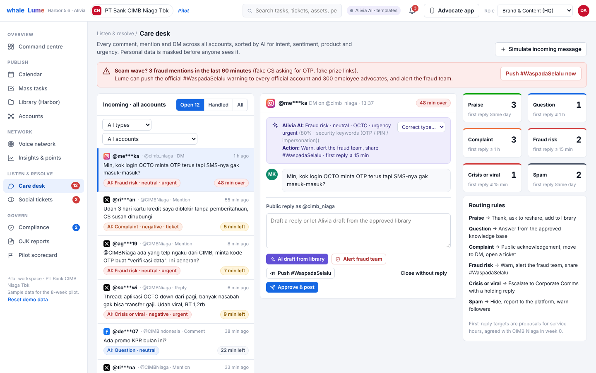
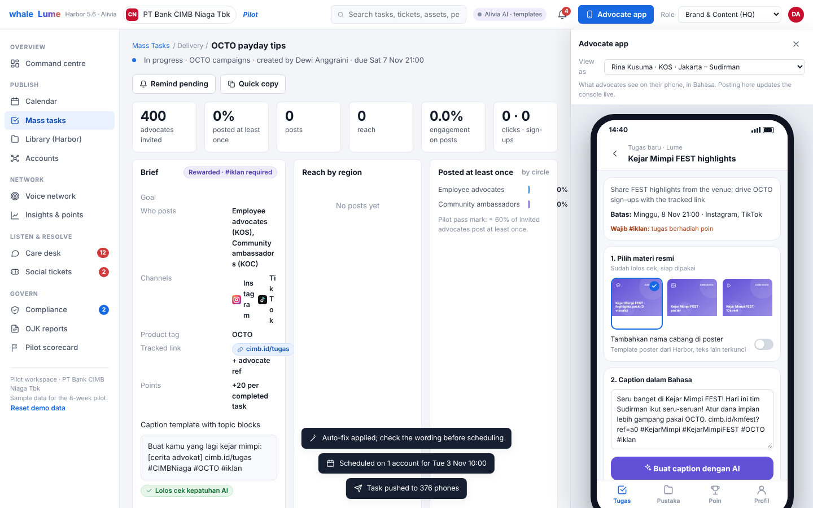

<p align="center"></p>

# Lume for CIMB Niaga

A working build of **Whale Lume**, the automated social media hub, configured for PT Bank CIMB Niaga Tbk's social media growth proposal: one console for every official and affiliated account, a compliant voice network of employees, community and creators, an AI care desk that turns complaints into tracked tickets, and compliance checks for POJK 6/2026 and POJK 22/2023.

It runs as a single web page and as native desktop apps for Windows and macOS. All accounts, advocates, messages and tickets are **sample data** for the 8-week pilot.



## What's inside

| Area | What it does |
|---|---|
| **Command centre** | Mentions, sentiment, median first reply, open tickets and OJK on-time rate; scam-wave alert that pushes #WaspadaSelalu to all official accounts and 300 advocates; daily brief |
| **Calendar** | All official and affiliated accounts on one week; detects campaign clashes and auto-staggers launches (main account announces first) |
| **Mass tasks** | Lume-style task list, create-task wizard (circles, regions, channels, Harbor assets, topic blocks, tracked `cimb.id` links, points), execution table per advocate |
| **Library (Harbor)** | BGC / PGC / UGC / SGC assets with clearance status, upload with AI check, approved reply library, knowledge base and product sheets |
| **Accounts** | Capability matrix for the 9 accounts, family scorecard, verified family register (blue-tick rule), fake-account watch |
| **Voice network** | Four circles (official, KOS employees, KOC community, KOL creators), opt-in advocates, invite flow |
| **Insights & points** | Completion, reach, engagement, clicks and sign-ups by task, circle and region; six leaderboards; points rules with quality guardrails |
| **Care desk** | One queue for every account, AI triage by type, sentiment, product and urgency, personal-data masking, first-reply countdowns, reply drafting from the approved library |
| **Social tickets** | SM- tickets routed to owner teams, the POJK 22/2023 clock (10 working days + 10 with written notice), full audit trail |
| **Compliance** | Six AI checks (guaranteed returns, disclosure, risk wording, product facts, personal data, tone and comparisons), auto-fix, review queue, POJK 6/2026 creator register, audit log |
| **OJK reports** | SEOJK 20/2025 half-year report: top 10 complaint causes and negative-coverage log |
| **Pilot scorecard** | W0–W8 plan and the 10 pass marks, computed live from the workspace |
| **Advocate app (Bahasa)** | Phone app beside the console: task → approved assets → AI caption → compliance check → one-tap publish → points |

Use the **Role** switcher in the top bar to see each team's permissions (Brand, Care desk, Compliance, KejarMimpi, HR, Syariah).

📘 **[User guide with step-by-step pictures](docs/USER_GUIDE.md)** · [PDF version](docs/Lume-User-Guide.pdf)

| Care desk | Advocate app |
|---|---|
|  |  |

## Run it

Full install steps, including the first-launch security prompts, are in the [user guide](docs/USER_GUIDE.md#1-install-and-open).


**Web:** open [`web/dist/lume-cimb-niaga.html`](web/dist/lume-cimb-niaga.html) in Chrome, Edge or Safari. No server or install needed.

**Desktop:** download from [`releases/v1.0.0`](releases/v1.0.0):

- [`Lume-for-CIMB-Niaga.exe`](releases/v1.0.0/Lume-for-CIMB-Niaga.exe) or [`Lume-for-CIMB-Niaga-Windows.zip`](releases/v1.0.0/Lume-for-CIMB-Niaga-Windows.zip) for Windows
- [`Lume-for-CIMB-Niaga-macOS.zip`](releases/v1.0.0/Lume-for-CIMB-Niaga-macOS.zip) for macOS
- [`INSTALL.txt`](releases/v1.0.0/INSTALL.txt): first-launch steps, data locations and uninstall


- Windows 10/11: `Lume for CIMB Niaga.exe`, single file. Needs the WebView2 Runtime, which is already on almost every Windows 10/11 PC.
- macOS 14 Sonoma or later: universal `.app` for Apple Silicon and Intel.
- The builds are not code-signed yet, so the first launch shows a security prompt. On Windows: *More info → Run anyway*. On Mac: *System Settings → Privacy & Security → Open Anyway*.

## Build

```bash
# Web app: bundles web/src into one self-contained HTML file
cd web && python3 build.py            # → web/dist/lume-cimb-niaga.html

# Tests (Playwright + Chromium)
node test/routes.js && node test/flows.js && node test/smoke.js

# Desktop apps (Go 1.22+, no cgo): see desktop/README-BUILD.md
cd desktop && ./build.sh
```

The desktop shell (`desktop/`) embeds the web build and serves it from `127.0.0.1:47616`, so saved data persists between launches. Windows uses WebView2 and macOS uses WKWebView, through [go-webview](https://github.com/abemedia/go-webview) (MIT) and [purego](https://github.com/ebitengine/purego) (Apache-2.0), both vendored in `desktop/third_party`.

## Notes

- **Sample data.** Account figures come from Social Blade public data (about 22 October 2026), as cited in the proposal. Advocates, creators, messages and tickets are fictional.
- **Product facts are placeholders.** Rates, tenors and fees on the product sheets (for example, KPR 3.88%) exist only to demonstrate the product-facts check. Replace them with CIMB Niaga's real product sheets.
- **AI.** Captions, replies and the daily brief come from the approved template library. The published claude.ai version can write them live with Claude. The compliance checks are deterministic rules.
- **Regulation summaries** (POJK 6/2026, POJK 22/2023, SEOJK 20/2025) are summaries only; CIMB Niaga Compliance and Legal confirm how each rule applies.
