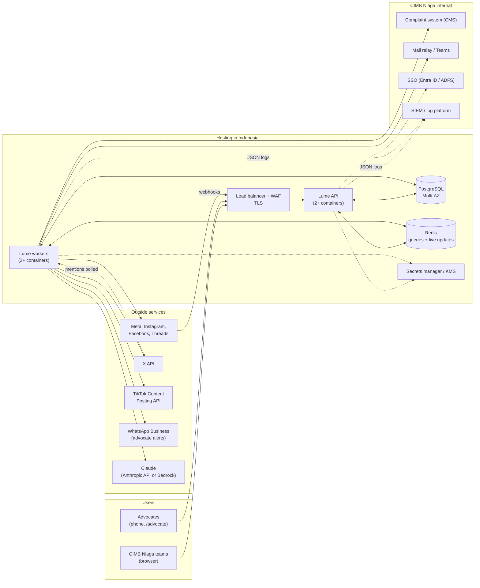

# CIMB Niaga Social Hub · Engine and infrastructure

**Version 1.2.0 · November 2026 · For Whale engineering, CIMB Niaga IT, InfoSec, Compliance and Digital Marketing**

The Social Hub console (the CIMB Niaga edition of Lume) now has a back end, the **Lume engine** in [`server/`](../server). This page explains what the engine does, what it needs to run, and what CIMB Niaga and Whale must arrange before it touches real accounts.

> This page summarises regulations to help plan the work. It is not legal advice. CIMB Niaga's Compliance, Legal, IT Risk and Data Protection Officer confirm what applies.

## 1. What the engine adds

| Before (console only) | With the engine |
|---|---|
| Each browser or desktop app keeps its own copy of the sample data | One shared workspace in PostgreSQL; everyone sees changes live |
| Sign-in checked on the device | Sign-in checked on the server, sessions, lockout; ready for CIMB Niaga SSO |
| Compliance checks run in the browser | The same checks re-run on the server for every post, reply, task and advocate caption; a tampered browser can't skip them |
| *Publish* and *Reply* are simulated | The engine publishes and replies through Instagram, Facebook, Threads and X; TikTok publishing after TikTok's audit |
| Incoming messages are sample data | Comments, mentions and DMs arrive by webhook (Meta) or polling (X), masked and classified on arrival |
| Ticket numbers made in the browser | Numbers issued by the server, registered in CIMB Niaga's complaint system, OJK clock watched around the clock |
| Alerts only on screen | Fraud team, Corporate Comms, Compliance and ticket owners alerted by e-mail or Teams/Slack webhook |
| Advocate app is a demo phone | Advocates get a WhatsApp message and a personal link to a mobile page (`/advocate`); links are verified and points awarded |
| No server-side record | Hash-chained audit log, a record of every outbound call, complaint register export (CSV) |

The engine runs in **sandbox mode** by default: every platform call is simulated (with real-looking IDs and links) so the pilot and UAT can run end to end without touching CIMB Niaga's live accounts. Switching to **live mode** is a setting once the platform access in section 6 is in place.

## 2. How it fits together

| Piece | Job |
|---|---|
| **API** (`node dist/index.js api`) | Serves the console and the advocate page, sign-in, the shared workspace, permission and compliance gate, live updates (Server-Sent Events), webhooks |
| **Workers** (`… worker`) | Publish due posts every 30 s, send replies, hide comments, register tickets in CMS, OJK clock sweep every 5 min, scam-wave detection, advocate notifications and link checks, metrics every hour, X mentions every 2 min, nightly clean-up |
| **PostgreSQL** | The workspace, users and sessions, encrypted platform tokens, audit log, delivery records, raw webhook events (purged after 30 days) |
| **Redis** | Job queues with retries, and the live-update channel between API containers |

Both API and worker are the same container image, stateless and horizontally scalable.

## 3. What to run

### Pilot / UAT (8 weeks, sandbox or a few live accounts)

| Item | Size |
|---|---|
| Application | One VM, 4 vCPU / 8 GB, running `docker compose` (API, worker, PostgreSQL, Redis), **or** the managed set-up below at its smallest size |
| Storage | 50 GB SSD, daily snapshot |
| Network | One HTTPS domain (e.g. `social-hub-uat.<bank domain>`), certificate, WAF in front |
| Users | ~50 staff, up to 1,000 advocates, a few thousand incoming messages a day |

### Production

| Item | Starting size | Notes |
|---|---|---|
| API containers | 2–3 × (1 vCPU, 2 GB), across availability zones | Autoscale on CPU and open connections (each signed-in user holds one live-update connection) |
| Worker containers | 2 × (1 vCPU, 2 GB) | Scale with queue depth |
| PostgreSQL 16 (managed) | 4 vCPU / 16 GB, 200 GB SSD, Multi-AZ, point-in-time recovery 35 days | Add a read replica for reporting if needed |
| Redis 7 (managed) | 2–4 GB, primary + replica, encryption in transit | Not the system of record; can be rebuilt |
| Object storage | 200 GB to start | For library images and videos (see section 8) |
| Load balancer + WAF | HTTPS only, HSTS, rate limits on `/api/v1/auth/login` and `/webhooks/*` | Idle timeout ≥ 120 s for live updates |
| Secrets manager + KMS | `DATA_KEY`, database password, platform tokens, API keys | Rotate yearly or on staff change |
| Logs and monitoring | JSON logs to the SIEM; alerts on `/api/v1/health`, failed deliveries, queue depth, OJK at-risk tickets | |
| Environments | DEV, UAT, PROD, each with its own database and keys | UAT stays in sandbox mode |

Recovery targets to agree with IT: RPO ≤ 5 minutes (database point-in-time recovery), RTO ≤ 4 hours (redeploy containers, restore database). A disaster-recovery copy must also stay in Indonesia (section 4).

## 4. Where to host: Indonesian rules

- **Data centre location.** POJK 11/POJK.03/2022 requires a bank to place its electronic systems in a data centre and a disaster recovery centre in Indonesia; placement outside Indonesia needs OJK approval. The hub stores customer messages, complaint records and advocate data, so plan for hosting in Indonesia. OJK's FAQ adds that when a bank uses a cloud provider located outside Indonesia, the rules on placing systems outside Indonesia still apply.
- **Third-party providers.** OJK Board of Commissioners Regulation 1/2026, which took effect on 1 March 2026, implements POJK 11/2022 and replaces SEOJK 21/SEOJK.03/2017. It requires due diligence before selecting an IT provider, a written agreement, and reassessment when a provider changes significantly. Whale, the cloud provider and the AI provider each need this.
- **Personal data.** The PDP Law (UU 27/2022) already applies. Its implementing regulation, PP 33/2026, was issued on 16 July 2026 and takes effect on 16 January 2027. It sets out cross-border transfers in three tiers: adequacy, binding safeguards, and consent. Expect a data protection impact assessment for the hub.

**Practical choices, all with a region in Jakarta:** AWS Asia Pacific (Jakarta) `ap-southeast-3`, Microsoft Azure Indonesia Central, Google Cloud `asia-southeast2`, Alibaba Cloud `ap-southeast-5` and Tencent Cloud `ap-jakarta`. CIMB Niaga's own data centre or private cloud works just as well: the engine is plain containers, PostgreSQL and Redis.

**What still leaves Indonesia, and how the engine limits it**

| Flow | What goes out | Control |
|---|---|---|
| Social platforms (Meta, X, TikTok) | Posts and public replies, which are public by nature | Only text approved by the compliance check; customer messages are masked before storage |
| Claude (AI drafts) | The drafting prompt | Personal data (card, account, phone, e-mail, OTP) is masked before sending; AI can be left off and the template library used instead. Amazon Bedrock is available in the Jakarta region, but Claude there is offered through global cross-Region inference, which routes requests to more than 20 AWS regions, so treat AI calls as a cross-border transfer and get the DPO's view |
| WhatsApp Business | Advocate first name, task name, deadline | Approved template only |

## 5. Network and security checklist

| Area | Setting |
|---|---|
| Public endpoints | `/` and `/api/*` (staff console: put behind SSO and, if wanted, CIMB Niaga's network or VPN), `/advocate` and `/api/v1/advocate/*` (advocates' phones), `/webhooks/meta` and `/webhooks/x` (platforms; signatures checked) |
| Outbound allow-list | `graph.facebook.com`, `graph.threads.net`, `api.x.com`, `open.tiktokapis.com`, `api.anthropic.com` (or the Bedrock endpoint), the CMS host, the mail relay, the Teams/Slack webhook |
| Sessions | `httpOnly`, `Secure`, `SameSite=Lax` cookie (so links in alert e-mails open signed in); 12-hour sliding session; 7 days only if *remember me*; a custom header on every change blocks cross-site requests |
| Passwords | scrypt hashing; lockout after 5 failures (set `LOGIN_LOCK_SECONDS=900` for production). Replaced by SSO in production |
| Secrets at rest | Platform tokens encrypted with AES-256-GCM using `DATA_KEY` from the secrets manager; the engine refuses to start in production without it |
| Personal data | Masked on arrival (card, NIK, account, phone, e-mail, OTP); raw webhook payloads deleted after `RAW_EVENT_RETENTION_DAYS` (30) |
| Audit | Every change, rejection, delivery, sign-in and reset is logged; the log is hash-chained and `/api/v1/audit/verify` checks it |
| Browser hardening | Content-Security-Policy, `X-Frame-Options: DENY`, `nosniff`, HSTS behind HTTPS |
| Before go-live | Penetration test, vulnerability scan of the image, load test, DPIA, IT risk assessment and the provider due diligence above |

## 6. Accounts and approvals to arrange

| Platform | What CIMB Niaga / Whale needs | Notes |
|---|---|---|
| **Meta** (Instagram, Facebook Pages, Threads) | A Meta app with Business Verification; Instagram professional accounts linked to Facebook Pages; long-lived tokens per account; webhooks for `comments`, `mentions`, `feed` and `messages` pointed at `/webhooks/meta` | Permissions with Facebook Login: `instagram_basic`, `instagram_content_publish`, `instagram_manage_comments`, `instagram_manage_insights`, `instagram_manage_messages`, `pages_show_list`, `pages_read_engagement`, plus `pages_manage_posts`, `pages_manage_engagement`, `pages_messaging` and the Threads permissions. If the app is owned by CIMB Niaga's Business Manager and serves only its own accounts, Standard Access is all the app needs. If Whale's app serves the accounts as a tech provider, Business Verification is required for all apps making requests for Advanced Access. Graph API version is a setting (`META_GRAPH_VERSION`, default v26.0). |
| **X** | Developer account, project and app; OAuth 2.0 user token for @CIMBNiaga; credits | X now bills per use, roughly $0.005 to read a post, $0.015 to create one and $0.20 to create one with a link (check X's current rate card). Mentions are polled every 2 minutes, so reads are the main cost; the Account Activity webhook needs an enterprise agreement |
| **TikTok** | Developer app with Login Kit and the Content Posting API (Direct Post), domain verification for media URLs, then TikTok's audit | Until the audit passes, every direct post is forced to SELF_ONLY, visible only to the account. TikTok has no comment-reply API for partner apps, so TikTok replies stay in TikTok Studio (the engine marks them "post it in the platform") |
| **WhatsApp Business Platform** | A number on CIMB Niaga's WhatsApp Business account (or its BSP) and an approved template, default name `lume_task_new` | Used to tell advocates about new tasks and reminders |
| **CIMB Niaga complaint system** | An API endpoint and token to create a complaint from a social ticket; field mapping (product, category, owner unit) | Until then the engine issues `CMS-` references itself (sandbox) |
| **Claude** | An Anthropic API key, or Claude through Amazon Bedrock | Optional; without it, drafts come from the approved template library |
| **E-mail / chat** | Mail relay address, distribution lists for the fraud team, Corporate Comms, Compliance and the care desk; or one Teams/Slack webhook | |
| **SSO** | An OIDC or SAML app in CIMB Niaga's identity provider, with directory groups for the six teams | To build (section 8) |

## 7. Day-to-day running

- **Deploy:** one image ([`server/Dockerfile`](../server/Dockerfile)) for API and workers. Kubernetes, ECS or a VM with [`docker-compose.yml`](../docker-compose.yml). The first start creates the tables and the pilot workspace; later starts apply new migrations automatically (one container at a time).
- **Configure:** every setting is an environment variable, listed in [`server/.env.example`](../server/.env.example).
- **Watch:** `/api/v1/health` (database, Redis, mode); failed deliveries in `/api/v1/deliveries`; at-risk tickets raise alerts by themselves.
- **Support model:** Whale runs the engine and connectors; CIMB Niaga IT owns hosting, network, SSO, CMS and the mail relay; Compliance owns the check rules (changed in the console, Compliance role only).

## 8. Ready now, and still to do before production

**Ready and tested** (14 API tests and a two-person browser test, all passing in sandbox mode): shared workspace, live updates, sign-in with lockout, team permissions, server-side compliance gate, publishing and replies through the connectors, webhook intake and masking, ticket numbering and CMS hand-off, OJK clock and first-reply alerts, scam-wave alerts, advocate links and the advocate page, points, hash-chained audit, complaint CSV, AI drafting through the engine.

**Still to do:**

1. **Single sign-on** with CIMB Niaga's identity provider, mapping directory groups to the six teams (replaces the pilot passwords).
2. **Media library storage:** upload images and videos to object storage (with malware scanning) so Instagram and TikTok posts carry media. Today a post can carry `mediaUrls`, but the console's library is still sample data.
3. **Connect-account screen:** an OAuth "Connect" button per platform. Today an admin stores each account's token through the API.
4. **CMS field mapping** with CIMB Niaga's complaint system team.
5. **Platform access:** Meta app (Standard or Advanced Access), X credits, TikTok audit, WhatsApp template approval.
6. **Live-mode testing** on test accounts, then load test, penetration test, DPIA and OJK-related documentation.
7. **Docker image build** in CI: the Dockerfile is written but has not been built yet.

The desktop apps (Windows and macOS) stay as offline demo tools; they don't connect to the engine.

## Sources

- OJK, [POJK 11/POJK.03/2022 article 35](https://pasal.id/peraturan/pojk/peraturan-ojk-no-11-pojk-03-2022-tahun-2022/pasal-35) and the [OJK FAQ on POJK 11/2022](https://ojk.go.id:443/id/regulasi/Documents/Pages/Penyelenggaraan-Teknologi-Informasi-Oleh-Bank-Umum/FAQ%20POJK%2011%20-%2003%20-%202022.pdf)
- SSEK, [OJK Regulation No. 1 of 2026 on IT governance for commercial banks](https://ssek.com/blog/indonesias-financial-services-authority-strengthens-the-digital-backbone-of-banking-sector-through-regulation-no-1-of-2026-on-it-governance-for-commercial-banks/)
- RSM Indonesia, [PP 33/2026 client alert](https://www.rsm.global/indonesia/en/node/439); DFDL, [GR 33/2026 overview](https://www.dfdl.com/?p=67570)
- DGTL Infra, [Indonesia data center market snapshot](https://dgtlinfra.com/indonesia-data-center-market-snapshot/)
- AWS, [Amazon Bedrock in the Jakarta region](https://aws.amazon.com/about-aws/whats-new/2025/09/amazon-bedrock-asia-pacific-jakarta-region) and [Global cross-Region inference for Claude in Indonesia](https://aws.amazon.com/blogs/machine-learning/global-cross-region-inference-for-latest-anthropic-claude-opus-sonnet-and-haiku-models-on-amazon-bedrock-in-thailand-malaysia-singapore-indonesia-and-taiwan)
- Meta, [Instagram Platform overview](https://developers.facebook.com/documentation/instagram-platform/overview), [Permissions reference](https://developers.facebook.com/docs/permissions), [Graph API v26.0 changelog](https://developers.facebook.com/docs/graph-api/changelog/version26.0), [Threads posts](https://developers.facebook.com/docs/threads/posts/)
- X, [pay-per-use pricing summary (bundle.social)](https://bundle.social/blog/x-api-pricing-2026-costs-limits)
- TikTok, [Content Posting API: Direct Post](https://developers.tiktok.com/doc/content-posting-api-reference-direct-post) and [audit and private-mode restriction (PostPeer)](https://www.postpeer.dev/blog/tiktok-direct-posting-api-tutorial)
