# CIMB Niaga Social Hub · User Guide

**Powered by Lume · Version 1.1.0 · Pilot workspace · November 2026**

Lume is Whale's social media hub, set up here for PT Bank CIMB Niaga Tbk. Headquarters plans the content, people publish it from their own accounts, and the data comes back. One console runs every official and affiliated account, and it's where you:

- publish to all accounts from one calendar
- send approved content to employee, community and creator advocates
- answer every comment and message from one care desk
- turn complaints into tracked tickets
- check every post and reply for compliance before it goes out

This guide walks through every screen. In each picture, the **red numbered circles** match the numbered steps underneath it.

> All accounts, advocates, messages and tickets in the pilot workspace are **sample data**. Product facts such as rates, tenors and fees are placeholders until CIMB Niaga's real product sheets are loaded.

## Contents

1. [Open and sign in](#1-open-and-sign-in)
2. [Getting around](#2-getting-around)
3. [Roles and permissions](#3-roles-and-permissions)
4. [Command centre](#4-command-centre)
5. [Calendar](#5-calendar)
6. [Mass tasks](#6-mass-tasks)
7. [Library (Harbor)](#7-library-harbor)
8. [Accounts](#8-accounts)
9. [Voice network](#9-voice-network)
10. [Advocate app (Bahasa)](#10-advocate-app-bahasa)
11. [Insights and points](#11-insights-and-points)
12. [Care desk](#12-care-desk)
13. [Social tickets](#13-social-tickets)
14. [Compliance](#14-compliance)
15. [OJK reports](#15-ojk-reports)
16. [Pilot scorecard](#16-pilot-scorecard)
17. [10-minute demo script](#17-10-minute-demo-script)
18. [Troubleshooting and FAQ](#18-troubleshooting-and-faq)
19. [Glossary](#19-glossary)

---

## 1. Open and sign in

The CIMB Niaga Social Hub runs in your web browser. There is nothing to install.

> **Access link (CIMB Niaga team only):**
> [https://whale-alivia.stage.meetwhale.com/share/agi/artifact/5kBrYi3VWa6LnRfjRQhsH99d](https://whale-alivia.stage.meetwhale.com/share/agi/artifact/5kBrYi3VWa6LnRfjRQhsH99d)
>
> Use the link only for the pilot try-out and don't share it outside the CIMB Niaga team.

1. Open the link in **Chrome, Edge or Safari** on a laptop or desktop.
2. Bookmark it so you can come back.
3. Sign in with one of the pilot accounts below.

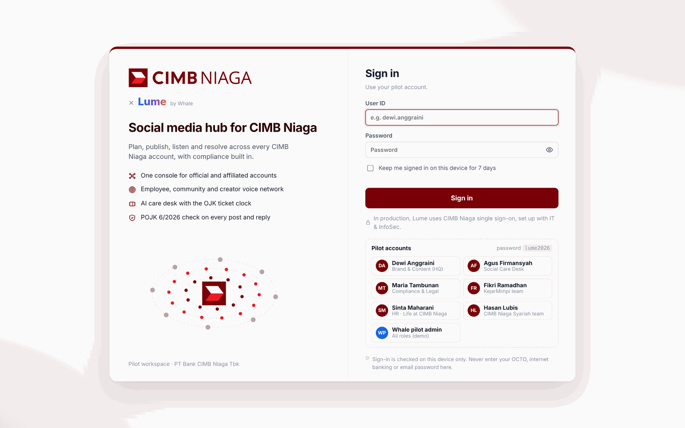

### Pilot accounts

Every account uses the password **`lume2026`**.

| User ID | Name | Team |
|---|---|---|
| `dewi.anggraini` | Dewi Anggraini | Brand and Content (HQ) |
| `agus.firmansyah` | Agus Firmansyah | Social Care Desk |
| `maria.tambunan` | Maria Tambunan | Compliance and Legal |
| `fikri.ramadhan` | Fikri Ramadhan | KejarMimpi team |
| `sinta.maharani` | Sinta Maharani | HR · Life at CIMB Niaga |
| `hasan.lubis` | Hasan Lubis | CIMB Niaga Syariah team |
| `whale.admin` | Whale admin | Every team (role switcher) |

- Tick **Remember me** to stay signed in on that browser for 7 days.
- After 5 wrong passwords, sign-in pauses for 30 seconds.
- A **Caps Lock** warning appears if Caps Lock is on.

### Signing out

Click your name at the top right (the account menu) and choose **Sign out**.

### Your data

Everything you change (tasks, replies, tickets, points) is saved in your browser and is still there next time you open the link on the same browser. Another browser or computer starts with its own copy. To start a demo from a clean state, use **Reset demo data** (see [Getting around](#2-getting-around)).

---

## 2. Getting around

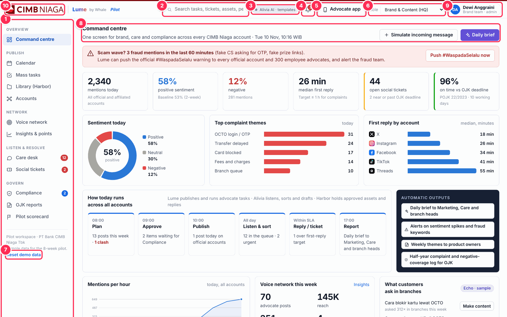

1. **Left menu.** It's grouped by job:
   - **Overview:** Command centre
   - **Publish:** Calendar, Mass tasks, Library, Accounts
   - **Network:** Voice network, Insights and points
   - **Listen and resolve:** Care desk, Social tickets
   - **Govern:** Compliance, OJK reports, Pilot scorecard

   Red badges count items that need attention. Blue badges count items waiting for Compliance.
2. **Search.** Finds tasks, tickets, assets, people and messages. Press **Ctrl+K** (⌘K on Mac) to jump to it.
3. **Alivia AI status.** *templates* means captions and replies come from the approved template library. *live* means Claude writes them; this happens only in the claude.ai web version.
4. **Notifications.** Scam waves, crises, items waiting for Compliance and tickets near their OJK deadline.
5. **Advocate app.** Opens the phone app that employees and community members use, beside the console.
6. **Role switcher** (whale.admin only). Lets you work as the Brand team, Care desk, Compliance, KejarMimpi, HR or Syariah team. See [Roles and permissions](#3-roles-and-permissions).
7. **Reset demo data.** Restores the original sample workspace. Use it before each demo.
8. **Page header.** Every page starts with its title, a one-line explanation and its main buttons on the right.
9. **Account menu.** Shows who is signed in and their team. Use it to sign out.
10. **CIMB Niaga logo.** Marks the workspace as CIMB Niaga's own hub.

| Notifications | Search |
|---|---|
| 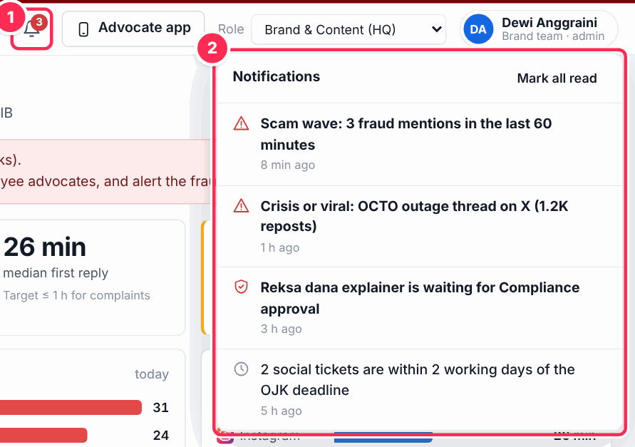 | 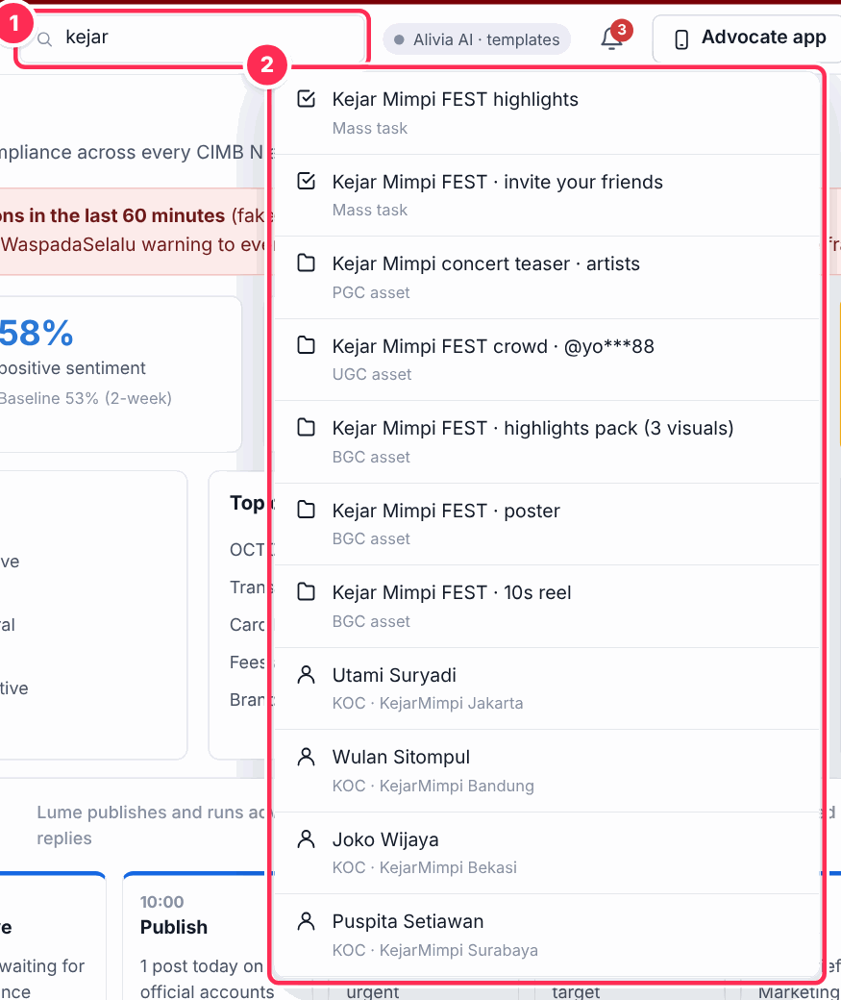 |

- **Notifications:** click the bell (1) to open the list (2). Click an item to go to it. **Mark all read** clears the red count.
- **Search:** type at least two letters (1). Results (2) show what each item is; click one to open it.

---

## 3. Roles and permissions

Each team publishes only to its own accounts. Compliance sees everything. Your role comes from the account you sign in with. To see every team, sign in as `whale.admin` and use the role switcher in the top bar.

| Role | Sign-in user | Can publish to | Main work |
|---|---|---|---|
| Brand and Content (HQ) | Dewi Anggraini | @cimb_niaga (Instagram, Threads), @cimb.niaga (TikTok), @CIMBIndonesia (Facebook), @CIMBNiaga (X) | Calendar, tasks, library, shared-calendar planning |
| Social Care Desk | Agus Firmansyah | None (replies only) | Care desk, tickets |
| Compliance and Legal | Maria Tambunan | None (approves) | Review queue, check rules, creator register, audit |
| KejarMimpi team | Fikri Ramadhan | @kejarmimpi.id | Community tasks and posts |
| HR · Life at CIMB Niaga | Sinta Maharani | @hycimbniaga | Employer-brand tasks, points rules |
| CIMB Niaga Syariah team | Hasan Lubis | @cimbniaga_syariah | Syariah posts |

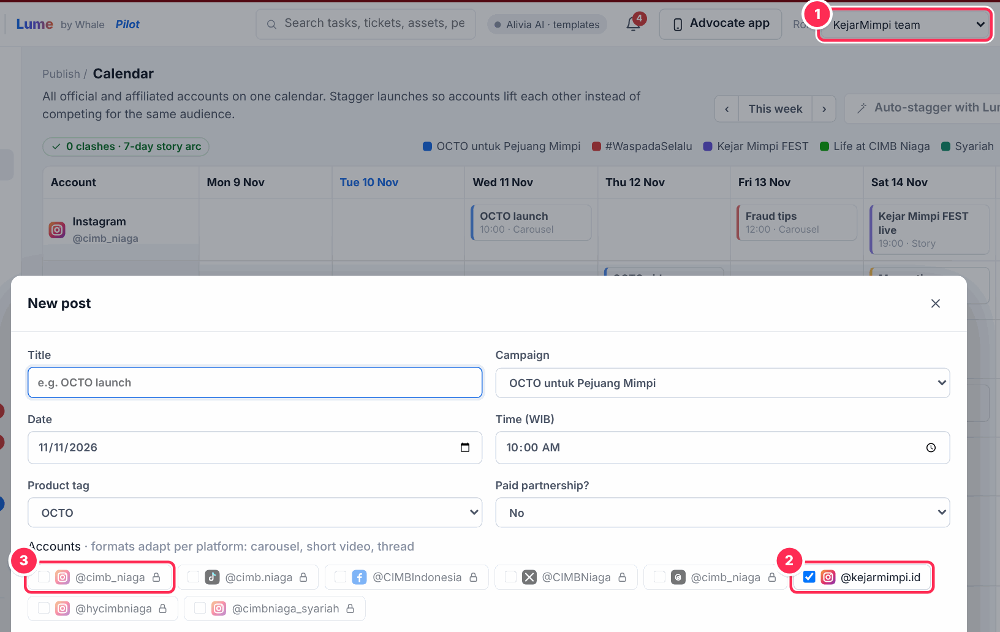

1. Here the role is set to **KejarMimpi team**.
2. When creating a post, the team's own account (@kejarmimpi.id) can be ticked.
3. Every other account shows a **lock**: it belongs to another team.

If you try something your role can't do, Lume tells you which team owns it.

---

## 4. Command centre

The first screen shows brand, care and compliance at a glance.

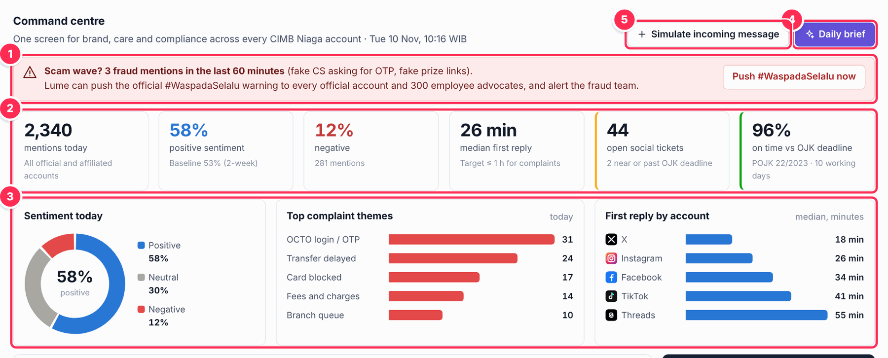

1. **Scam-wave alert.** Appears when 3 or more fraud mentions arrive within 60 minutes. Click **Push #WaspadaSelalu now** to do three things in one step:
   - schedule the official warning on all five official accounts
   - send a rapid task to 300 employee advocates
   - alert the fraud team
2. **Key numbers for today:**
   - mentions across all accounts
   - positive and negative sentiment, against the 2-week baseline
   - median first-reply time
   - open social tickets
   - the share of tickets on time against the OJK deadline
3. **Charts:**
   - sentiment split
   - top complaint themes
   - first-reply time per platform

   Hover any bar or chart segment for the exact value.
4. **Daily brief.** Builds today's summary (see below).
5. **Simulate incoming message.** Adds a test comment to the care desk. Useful in demos.

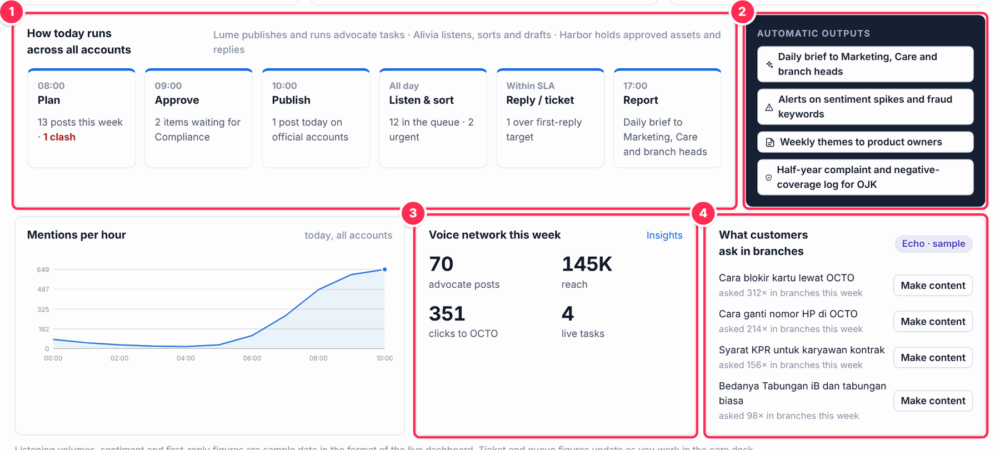

1. **How today runs.** The daily rhythm: 08:00 Plan, 09:00 Approve, 10:00 Publish, Listen all day, Reply within SLA, 17:00 Report. Each card shows live counts; click a card to go to that work.
2. **Automatic outputs:**
   - the daily brief
   - alerts on sentiment spikes and fraud keywords
   - weekly complaint themes for product owners
   - the half-year OJK log
3. **Voice network this week.** Advocate posts, reach, clicks to OCTO and live tasks.
4. **What customers ask in branches** (Echo). Click **Make content** to start a task that answers a question customers ask in branches.

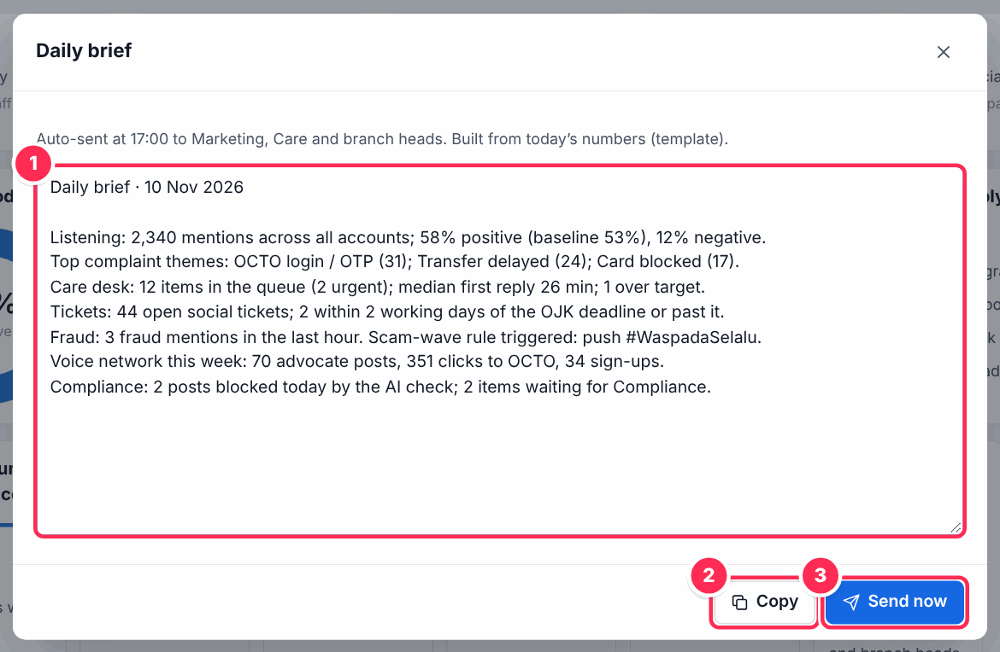

1. The brief is built from today's numbers. You can edit the text before sending.
2. **Copy** puts it on your clipboard, ready for email or chat.
3. **Send now** sends it to Marketing, Care and branch heads. In the pilot it goes out automatically at 17:00.

---

## 5. Calendar

All official and affiliated accounts are on one week, so launches don't compete for the same audience.

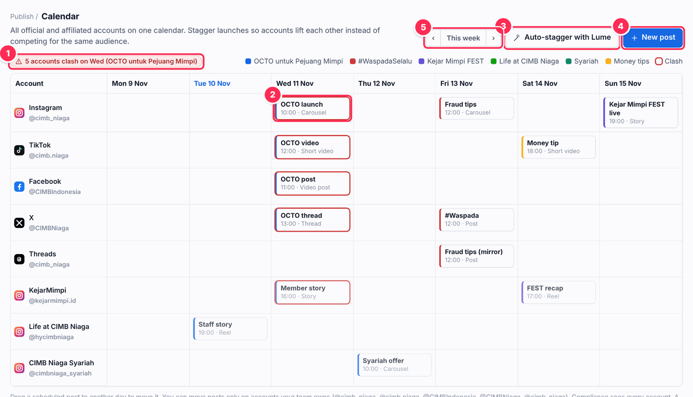

1. **Clash summary.** Here, *5 accounts clash on Tuesday*. A clash is the same launch campaign on more than one account on the same day.
2. **Clashing posts** have a red outline. Hover a post for its time, format and status.
3. **Auto-stagger with Lume.** Re-plans the campaign so the main account announces first and every other account gets its own day.
4. **New post.** Schedules a post on one or more of your team's accounts.
5. **Week navigation.** Move between weeks (‹ ›) or jump back to this week.

Fraud alerts (#WaspadaSelalu) are meant to go out on all accounts together, so they never count as clashes.

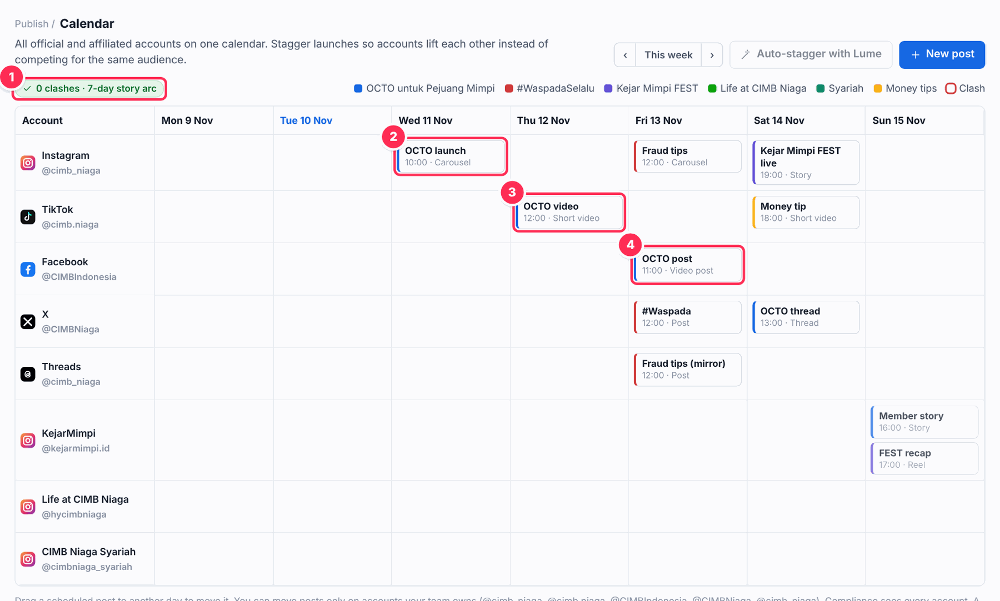

1. After auto-stagger: **0 clashes**, as a 7-day story arc.
2. Instagram announces first,
3. TikTok follows the next day,
4. then Facebook, X and the affiliated accounts.

**To move one post by hand:** drag it to another day in the same row. You can move posts only on accounts your team owns, and only to a time that hasn't passed. Click a post to see its details, publish it now or delete it.

### Create a post

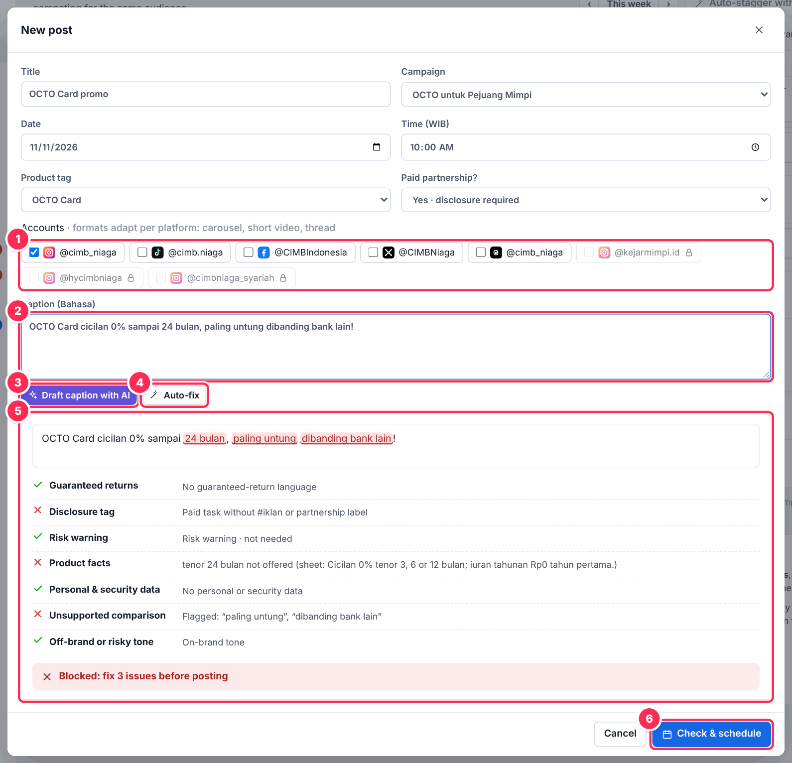

1. Tick the **accounts** to post to. Accounts owned by other teams are locked.
2. Write the **caption** in Bahasa, and choose the **product tag** and whether it's a **paid partnership** above it.
3. **Draft caption with AI** writes a caption from the approved product facts.
4. **Auto-fix** rewrites flagged wording for you.
5. The **AI compliance check** runs as you type. Flagged words are underlined in red; each line shows a check that passed (✓) or failed (✗). Here, three checks fail:
   - the tenor (24 months) isn't on the product sheet
   - "paling untung" and "dibanding bank lain" are unsupported comparisons
   - a paid post is missing the #iklan disclosure
6. **Check & schedule** schedules the post if the check passes.

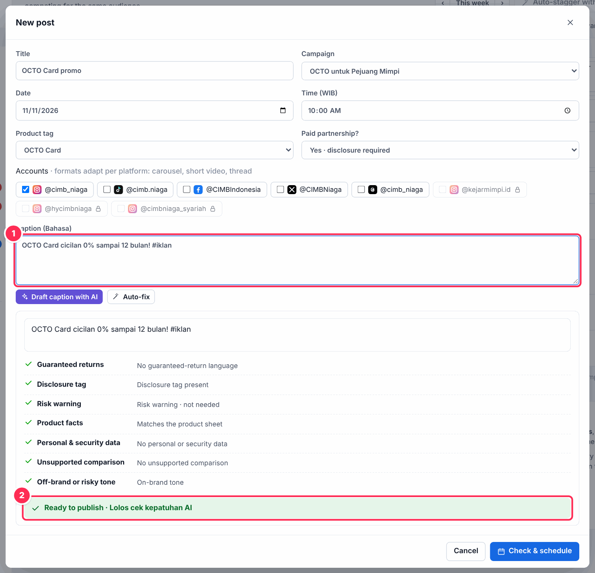

1. After **Auto-fix**:
   - the tenor is corrected to 12 months
   - the comparison is removed
   - `#iklan` is added
2. The verdict changes to **Ready to publish · Lolos cek kepatuhan AI**.

Always read the auto-fixed wording before you schedule. Posts tagged with a high-risk product (investment, insurance, pay-later) pass to **Compliance for approval** instead of publishing straight away.

---

## 6. Mass tasks

A mass task sends approved content to many advocates' phones at once. Each advocate posts it on their own accounts with an AI-drafted caption and a tracked link, and the results come back to Lume.

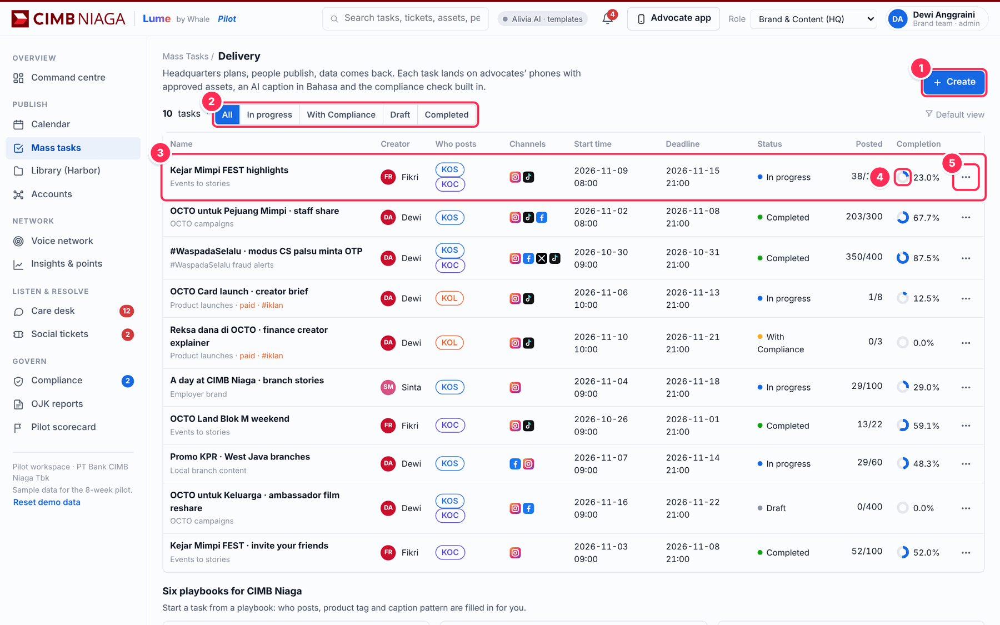

1. **Create** starts a new task.
2. **Status filter:** All, In progress, With Compliance, Draft or Completed.
3. **Task rows** show:
   - who created the task and who posts it (KOS, KOC, KOL)
   - the channels
   - the start time and deadline
   - status and how many advocates have posted

   Click a row to open the task.
4. **Completion ring:** the share of invited advocates who have posted.
5. **⋯ options:**
   - **Quick copy** makes a new draft with the same brief
   - **Remind** pushes a reminder to everyone who hasn't posted
   - **Terminate** stops the task
   - **Delete draft** is available for drafts only

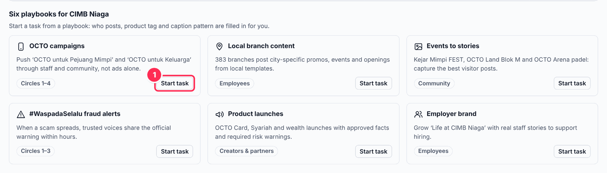

1. **Start task** from one of the six CIMB Niaga playbooks:
   - OCTO campaigns
   - local branch content
   - events to stories
   - fraud alerts (#WaspadaSelalu)
   - product launches
   - employer brand

   Who posts, the product tag and the caption pattern are filled in for you.

### Create a task

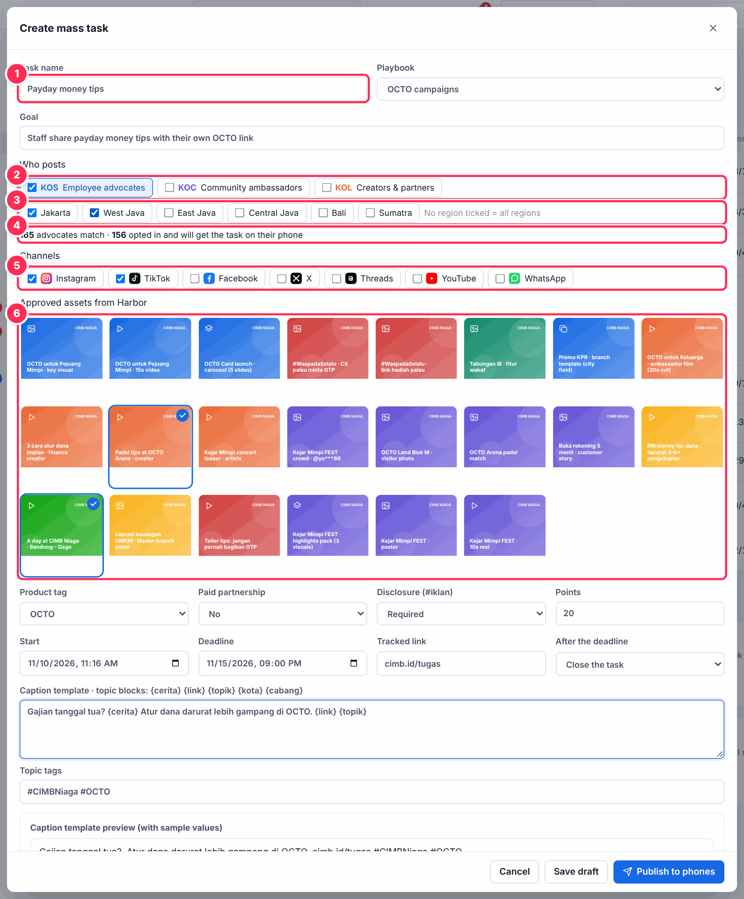

1. Give the task a **name** (and a goal underneath).
2. Choose **who posts**:
   - **KOS:** employees
   - **KOC:** community members
   - **KOL:** creators and partners
3. Optionally narrow by **region**. Leave all unticked for every region.
4. Lume shows **how many advocates match** and how many have opted in. Only opted-in people receive the task.
5. Choose the **channels**.
6. Pick **approved assets** from the Harbor library. Selected assets show a blue tick.

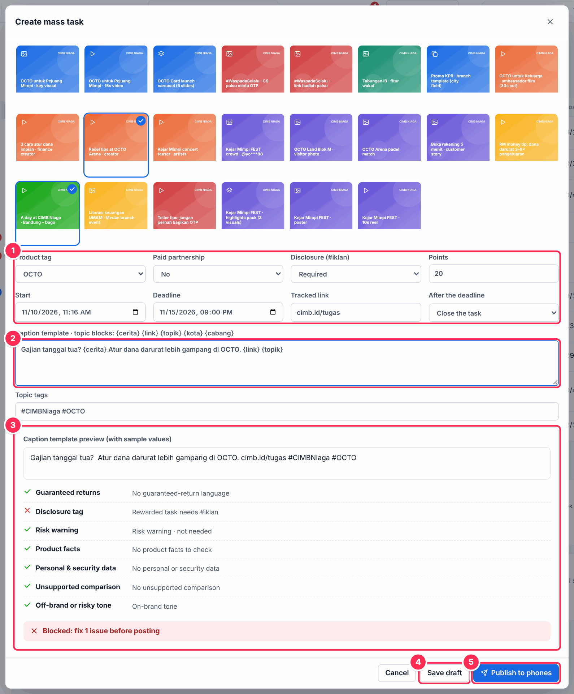

1. Set:
   - the **product tag**
   - whether it's a **paid partnership**: paid tasks always need disclosure and give no points
   - whether **#iklan is required**: on by default, because advocates earn points
   - the **points**, **start**, **deadline** and **tracked link**
   - whether the task **stays open after the deadline**
2. Write the **caption template**. Topic blocks are filled in on each advocate's phone:
   - `{cerita}` the advocate's own line
   - `{link}` their personal tracked link
   - `{topik}` the hashtags
   - `{kota}` the city
   - `{cabang}` the branch
3. The **AI check** runs on the template with sample values. A blocked template can't be published.
4. **Save draft** keeps it for later.
5. **Publish to phones** sends it to every opted-in advocate. A task tagged with a high-risk product goes to Compliance first.

### Follow a task

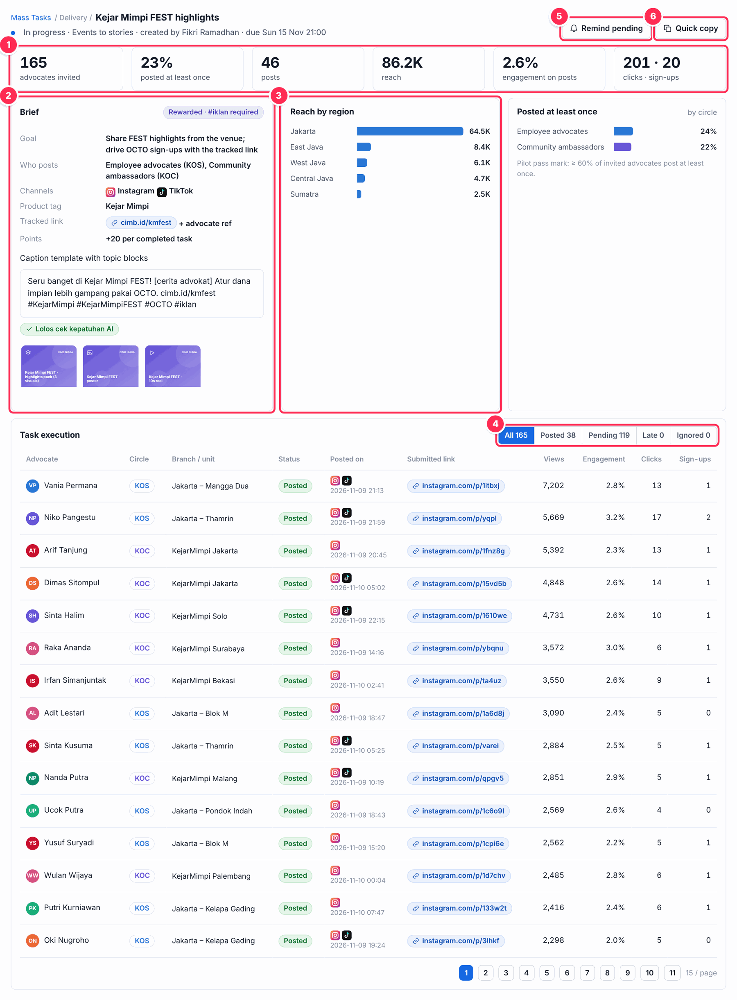

1. **Results:**
   - advocates invited
   - share who posted at least once
   - posts and reach
   - engagement on advocate posts
   - clicks and OCTO sign-ups
2. **Brief.** The goal, who posts, channels, tracked link, points, the caption template with its compliance status, and the assets.
3. **Reach by region** and **posted at least once by circle**. The pilot pass mark is 60%.
4. **Task execution.** Every advocate's status (Posted, Pending, Late, Ignored, Opted out), their submitted link and their post's results. Filter by status with these buttons.
5. **Remind pending** pushes a reminder to everyone who hasn't posted.
6. **Quick copy** reuses this brief for a new task.

---

## 7. Library (Harbor)

Every voice draws from one approved library.

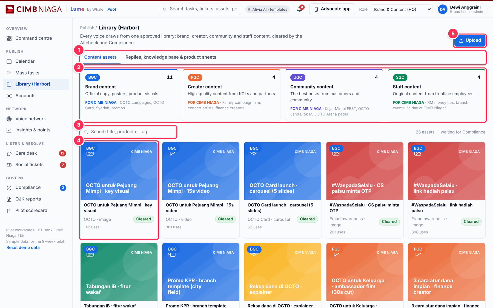

1. **Tabs:** *Content assets*, and *Replies, knowledge base & product sheets*.
2. **Four content sources.** Click a card to filter:
   - **BGC:** brand content, such as campaigns and posters
   - **PGC:** creator content from KOLs and ambassadors
   - **UGC:** community content; only posts whose owners gave permission
   - **SGC:** staff content from frontline employees
3. **Search** by title, product or tag.
4. **Assets** show their source, product, format, clearance status (*Cleared*, or *With Compliance*) and how often they've been used. Click one to open it.
5. **Upload** adds new content.

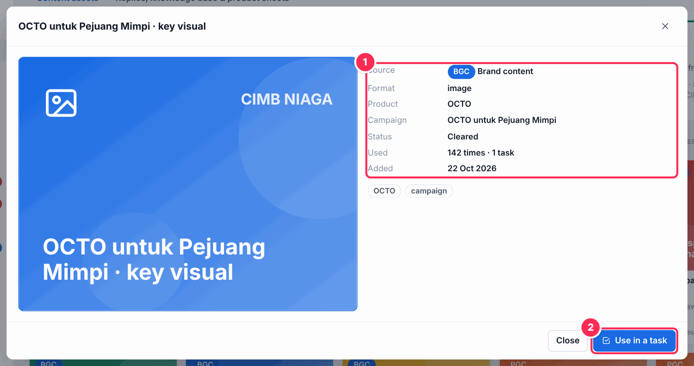

1. The asset's source, product, campaign, status and usage.
2. **Use in a task** starts a new mass task with this asset already selected.

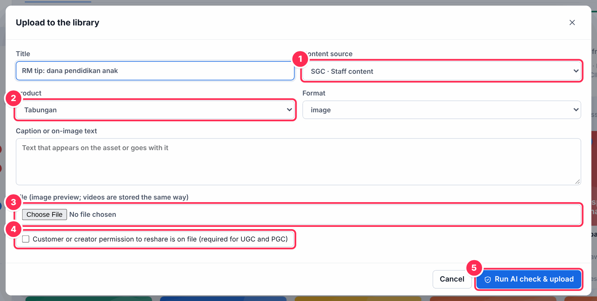

1. Choose the **content source** (BGC, PGC, UGC or SGC).
2. Choose the **product**. High-risk products go to Compliance after the AI check.
3. Attach the **file**. Images show as a preview.
4. For UGC and PGC, confirm that the **owner's permission to reshare** is on file. Upload is blocked without it.
5. **Run AI check & upload** checks the title and text. It also checks the image for ID cards or card numbers.

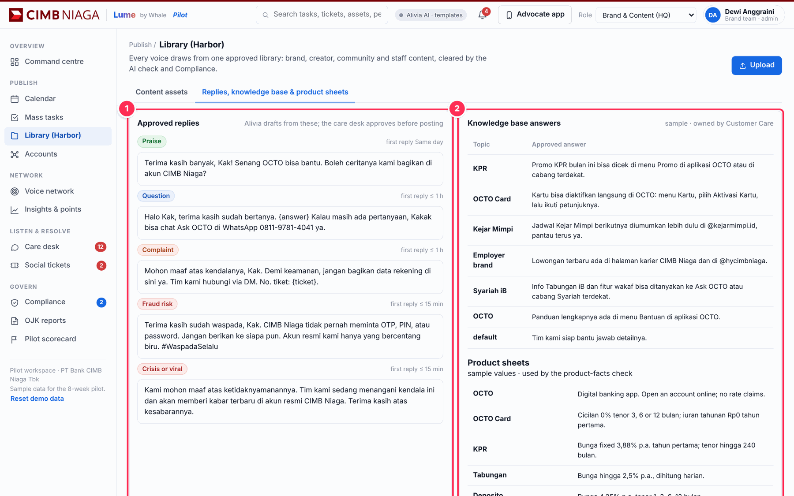

1. **Approved replies.** The care desk drafts from these: one per message type, each with its first-reply target.
2. **Knowledge base answers and product sheets.** These feed question replies and the product-facts check. Replace the sample product sheets with CIMB Niaga's real ones.

---

## 8. Accounts

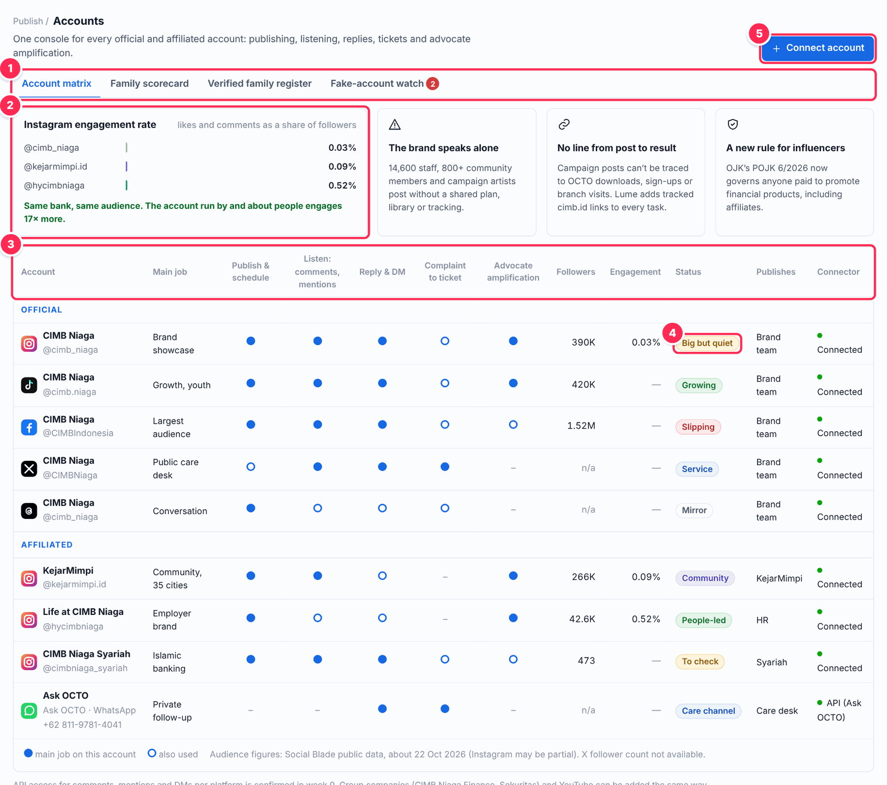

1. **Tabs:** Account matrix, Family scorecard, Verified family register, Fake-account watch.
2. **Instagram engagement rate.** The people-led @hycimbniaga engages about 17× more than the brand account.
3. **Capability matrix.** What each account is used for. ● is its main job; ○ means also used:
   - publish and schedule
   - listen
   - reply and DM
   - complaint to ticket
   - advocate amplification
4. **Status:** for example *Big but quiet*, *Growing*, *Slipping*, *To check*.
5. **Connect account** adds group companies (CIMB Niaga Finance, Sekuritas), venues (OCTO Land, OCTO Arena) or YouTube.

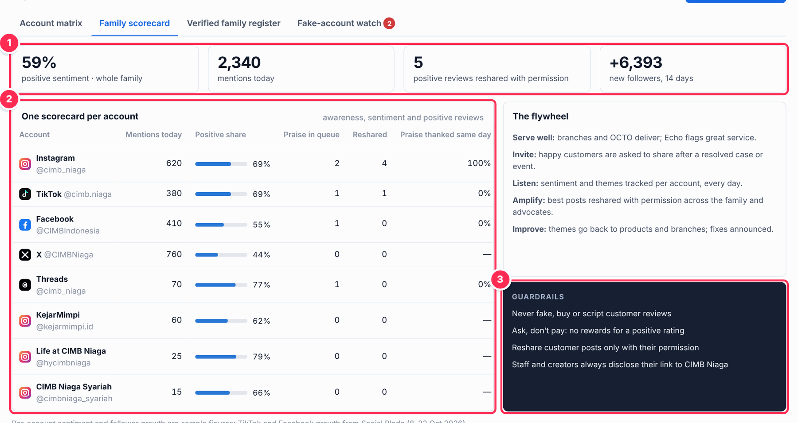

1. **Family totals:**
   - positive sentiment
   - mentions today
   - positive reviews reshared with permission
   - new followers
2. **One scorecard per account:** mentions, positive share, praise in the queue, reshares, praise thanked the same day, and follower change.
3. **Guardrails for reviews:**
   - never fake, buy or script reviews
   - ask, don't pay
   - reshare only with permission
   - staff and creators always disclose their link to CIMB Niaga

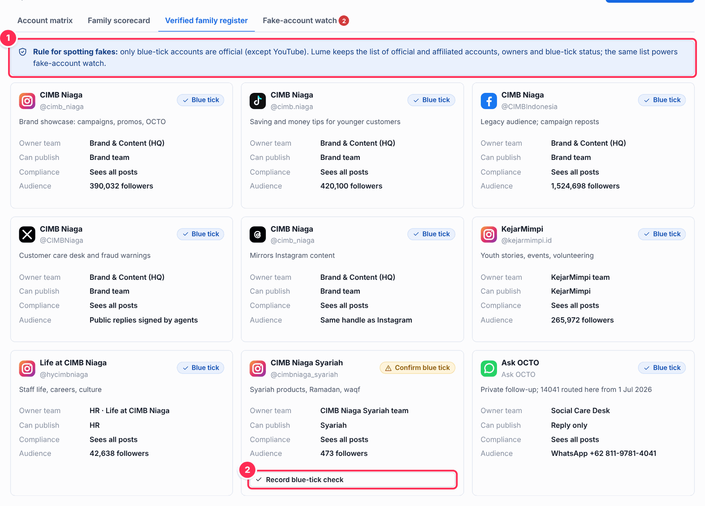

1. **The rule for spotting fakes:** only blue-tick accounts are official (YouTube is the exception).
2. **Record blue-tick check.** Shown for accounts still to confirm, such as @cimbniaga_syariah. Only Brand or Compliance can record it.

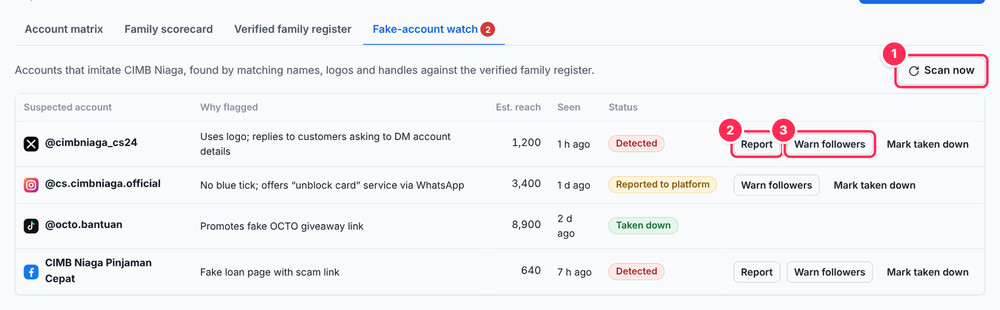

1. **Scan now** looks for new accounts imitating CIMB Niaga.
2. **Report** marks the account as reported to the platform.
3. **Warn followers** schedules a #WaspadaSelalu warning post on the matching official account. Use **Mark taken down** once the platform removes it.

---

## 9. Voice network

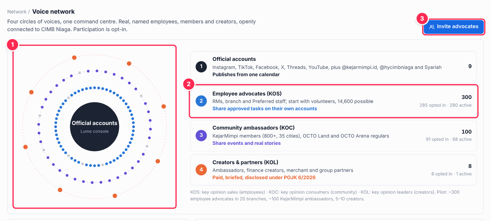

1. **Four circles** around the official accounts:
   - employees (blue)
   - community (purple)
   - creators (orange)

   Grey dots are people who opted out. Hover a dot to see who it is.
2. **Circle cards** show how many people were invited, how many opted in and how many are active.
3. **Invite advocates** gives you a ready-made invitation message in Bahasa and a join link per circle.

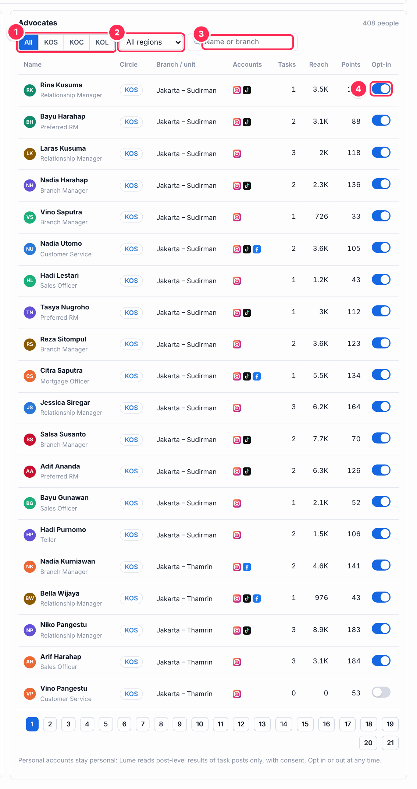

1. Filter by **circle**.
2. Filter by **region**.
3. **Search** by name or branch.
4. **Opt-in switch.** Participation is voluntary, and an advocate can leave at any time. Opted-out people receive no tasks.

Personal accounts stay personal: Lume reads only the results of task posts, with consent.

---

## 10. Advocate app (Bahasa)

This is what employees and community members see on their phones. Click **Advocate app** in the top bar to open it beside the console. Whatever an advocate posts here updates the console straight away.

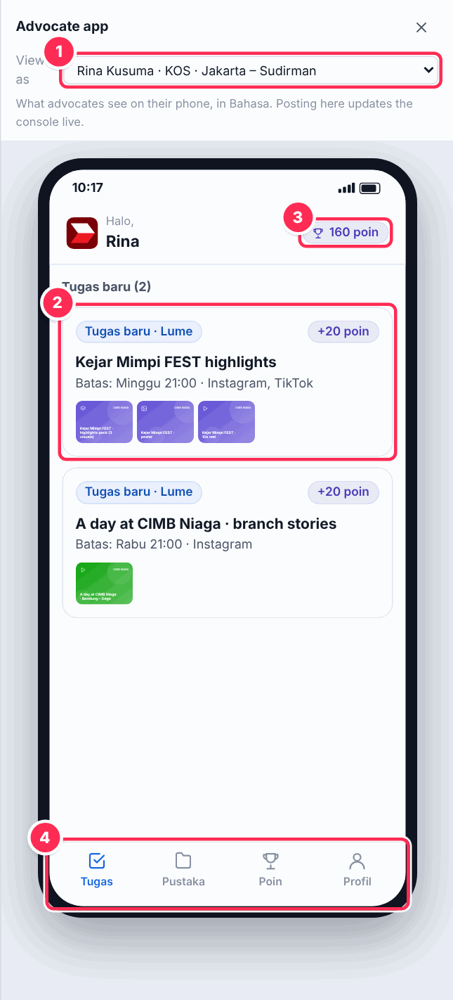

1. **View as.** Switch between the sample advocates:
   - Rina Kusuma: employee, Jakarta – Sudirman
   - a KejarMimpi member
   - a creator
2. **Tugas baru** (new task) cards show the deadline (*Batas*), the channels and the points.
3. The advocate's **points** total.
4. **Tabs:**
   - **Tugas:** tasks
   - **Pustaka:** library
   - **Poin:** points
   - **Profil:** profile

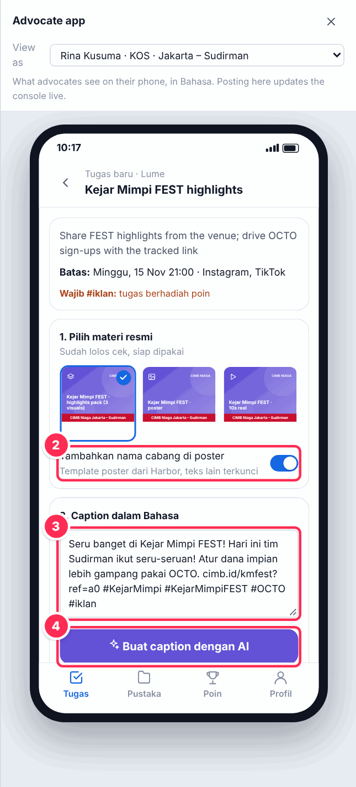

1. **Pilih materi resmi** (choose approved material). Tap the assets to use. They're already cleared.
2. **Tambahkan nama cabang di poster** (add branch name to the poster) adds the branch or city name to the poster. The rest of the template stays locked.
3. **Caption dalam Bahasa** (caption in Bahasa). The advocate can write their own or edit the AI draft.
4. **Buat caption dengan AI** (write caption with AI) drafts a caption that includes:
   - the advocate's own line
   - their personal tracked link (`cimb.id/...?ref=`)
   - the topic hashtags
   - `#iklan`

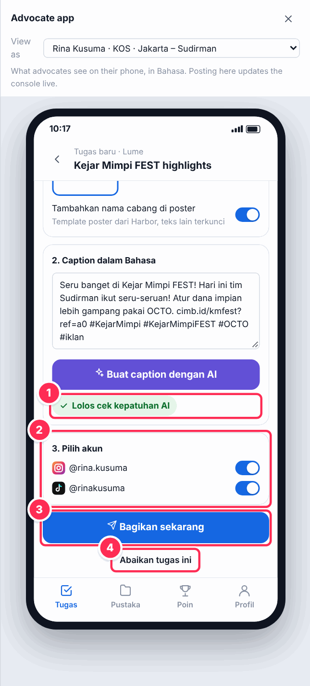

1. **Lolos cek kepatuhan AI** (passed the AI compliance check) means the caption is good to go. If it shows **Perlu diperbaiki** (needs fixing), tap **Perbaiki otomatis** (auto-fix).
2. **Pilih akun** (choose accounts). Pick which of the advocate's own connected accounts to post to.
3. **Bagikan sekarang** (share now) posts in one tap. It works only when the caption passes and an asset and an account are selected.
4. **Abaikan tugas ini** (ignore this task) declines the task.

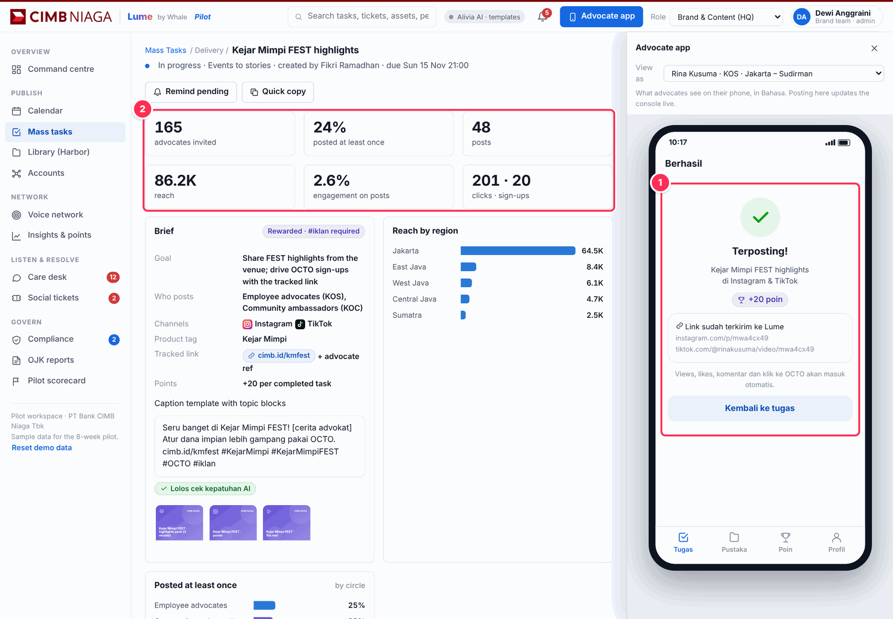

1. **Terposting!** (posted!) The phone confirms the post and the points earned. The link has gone back to Lume.
2. The console updates straight away: posts, reach, engagement and clicks keep coming in over the next minute.

| Points | Profile |
|---|---|
| 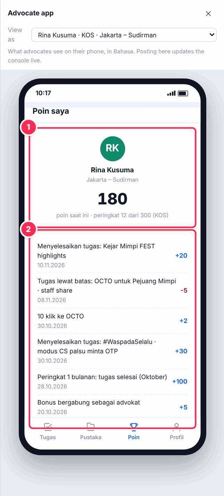 | 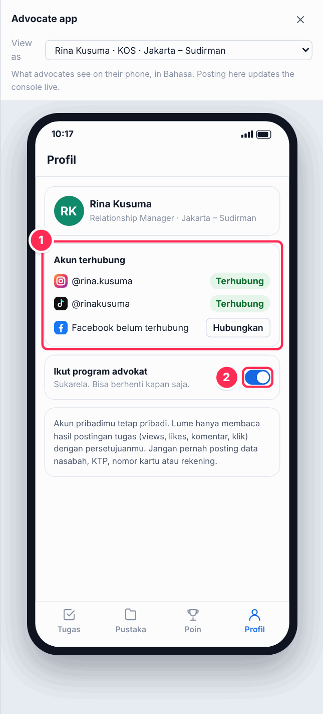 |

- **Poin** (points): (1) the total and rank in the advocate's circle, and (2) the history of every point earned or lost.
- **Profil** (profile): (1) connected accounts, and (2) the **Ikut program advokat** (join the advocate programme) switch. Turning it off stops all tasks.

---

## 11. Insights and points

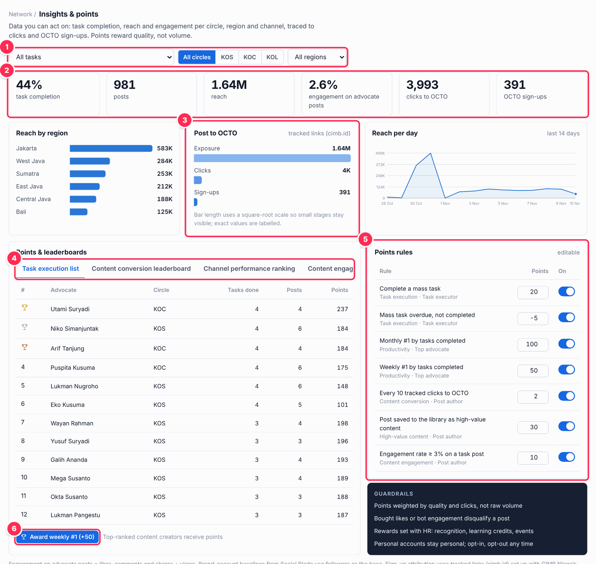

1. **Filters:** task, circle (KOS, KOC, KOL) and region.
2. **Results:** task completion, posts, reach, engagement on advocate posts, clicks to OCTO and OCTO sign-ups.
3. **Post to OCTO funnel:** exposure, then clicks, then sign-ups, from the tracked `cimb.id` links. Also on this row: **Reach by region** and **Reach per day**. Hover for exact values.
4. **Leaderboards:**
   - task execution
   - content conversion
   - channel performance
   - content engagement
   - high-value content
   - productivity (on-time rate)
5. **Points rules.** HR and the Brand team set the points and switch rules on or off. Examples:
   - +20 for completing a task
   - −5 for an overdue task
   - +2 per 10 clicks to OCTO
   - +30 for a post saved as high-value content
6. **Award weekly #1** gives the weekly top advocate their bonus. The ranking is weighted by quality and clicks, not by the number of posts.

The guardrails: bought likes or bot engagement disqualify a post. Rewards are set with HR (recognition, learning credits, events).

---

## 12. Care desk

Every comment, mention and DM from every account lands in one queue. Alivia AI sorts each one:

| Type | Example | What to do | First reply |
|---|---|---|---|
| Praise | "Makasih OCTO, transfer cepat banget!" | Thank, ask to reshare, add to library | Same day |
| Question | "Cara aktifkan kartu di OCTO gimana?" | Answer from the knowledge base | ≤ 1 h |
| Complaint | "Saldo terpotong tapi transfer gagal" | Acknowledge publicly, move to DM, open a ticket | ≤ 1 h |
| Fraud risk | "Ada akun CS CIMB minta OTP saya" | Warn, alert the fraud team, share #WaspadaSelalu | ≤ 15 min |
| Crisis or viral | A fast-spreading negative post | Escalate to Corporate Comms with a holding reply | ≤ 15 min |
| Spam | Fake "CIMB Niaga" accounts, scam links | Hide, report, warn followers | Same day |

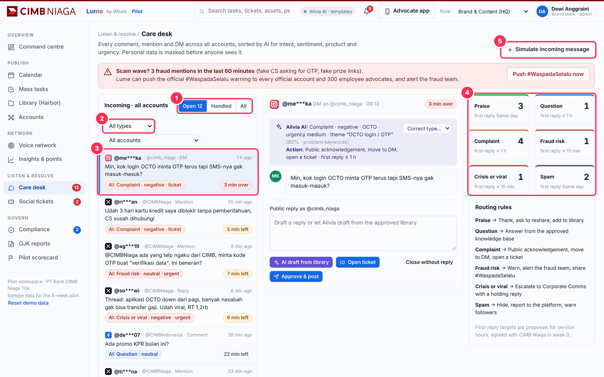

1. **Open / Handled / All.**
2. Filter by **type** or **account**.
3. **Queue items** show:
   - the masked handle
   - the account and platform
   - the message, with personal data masked (yellow)
   - the AI type
   - a **countdown to the first-reply target** (amber when under 10 minutes, red when over)

   The most urgent items come first.
4. **Type counters.** Click one to filter.
5. **Simulate incoming message** adds a test message.

### Answer a complaint

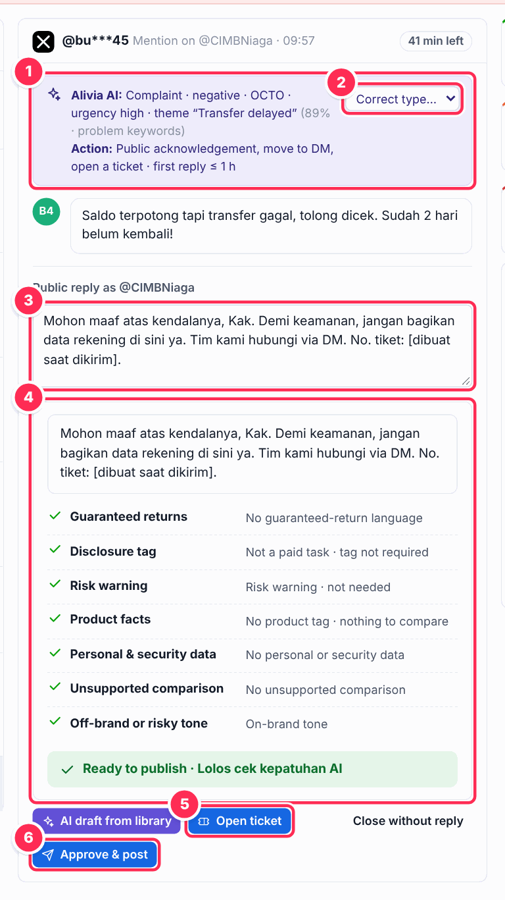

1. **Alivia AI's reading:** type, sentiment, product, urgency, complaint theme and confidence, plus the recommended action and reply target.
2. **Correct type…** fixes a wrong classification. Alivia learns from corrections.
3. The **public reply**. Click **AI draft from library** to fill it from the approved reply. Edit it as needed.
4. The **AI check** runs on every reply. It blocks replies that ask for a PIN, OTP, card or account number in public.
5. **Open ticket** creates an SM- ticket in CIMB Niaga's complaint system and routes it to the right team.
6. **Approve & post** publishes the reply. For a complaint without a ticket, Lume opens one automatically and puts the ticket number in the reply.

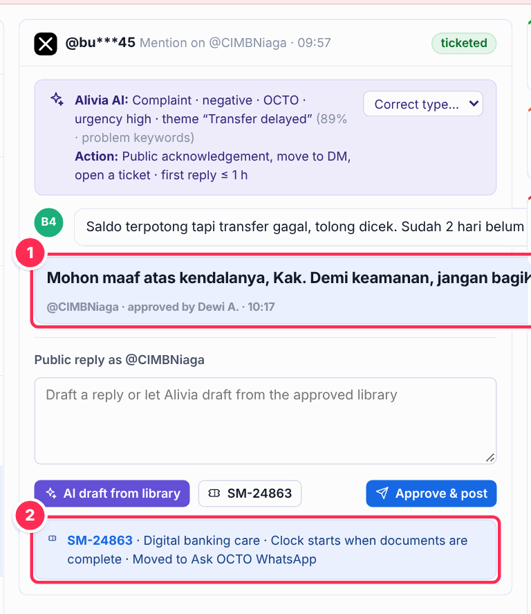

1. The reply is posted, with the ticket number in it.
2. The ticket link, owner team and OJK clock show under the thread.

### Fraud, praise, crisis and spam

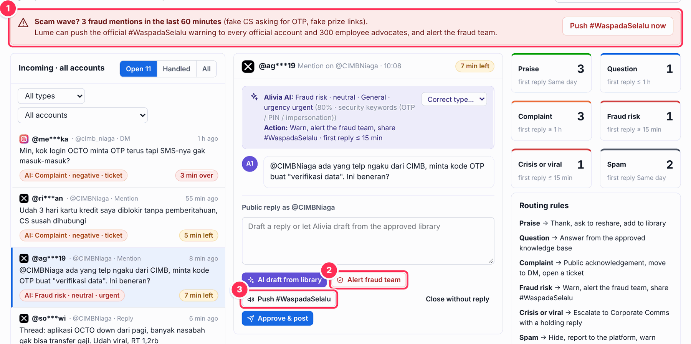

1. The **scam-wave banner** appears when fraud mentions spike.
2. **Alert fraud team** notifies the fraud team and drafts the official warning reply.
3. **Push #WaspadaSelalu** sends the warning to all official accounts and 300 advocates.

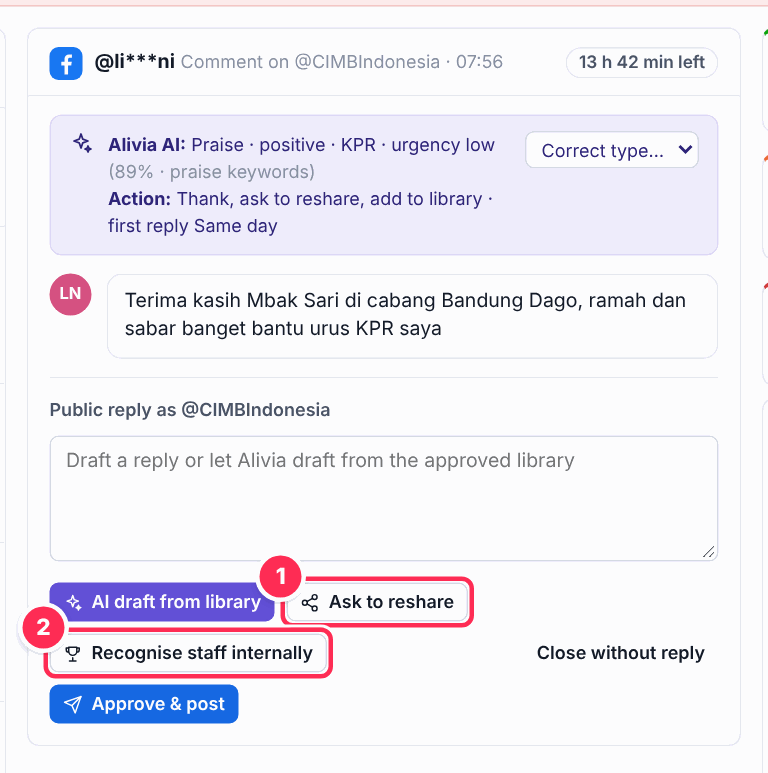

1. **Ask to reshare** drafts *"Boleh ceritanya kami bagikan di akun CIMB Niaga?"* ("May we share your story on CIMB Niaga's account?"). When the customer says yes, **Add to library & reshare via advocates** appears. It saves the post as UGC and starts a reshare task.
2. **Recognise staff internally** appears when the praise names an employee or branch. It shares the praise with the branch head and HR.

| Crisis or viral | Spam and impersonation |
|---|---|
| 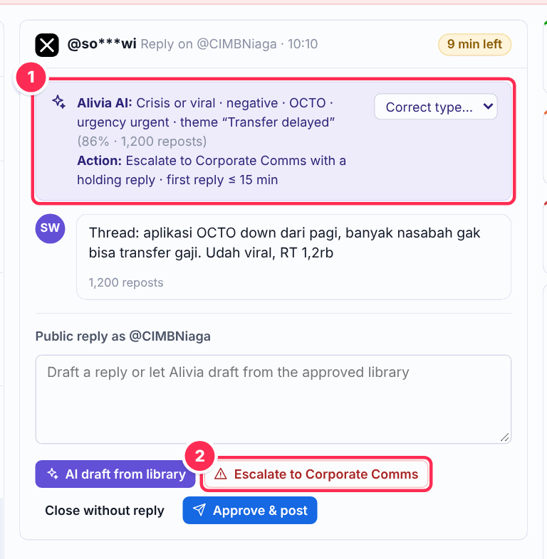 | 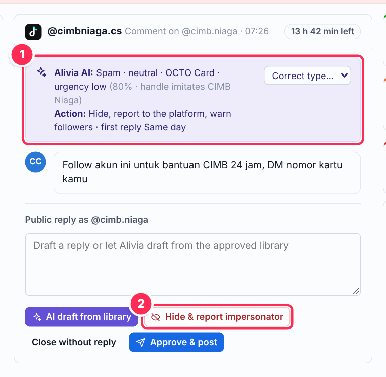 |

- **Crisis or viral:** (1) the AI flags the spread (for example, 1.2K reposts). (2) **Escalate to Corporate Comms** drafts the holding reply and logs it for the OJK negative-coverage report.
- **Spam:** (1) the AI flags scam links or a handle imitating CIMB Niaga. (2) **Hide & report** hides it and reports it. Impersonators are added to Fake-account watch.

### Try your own message

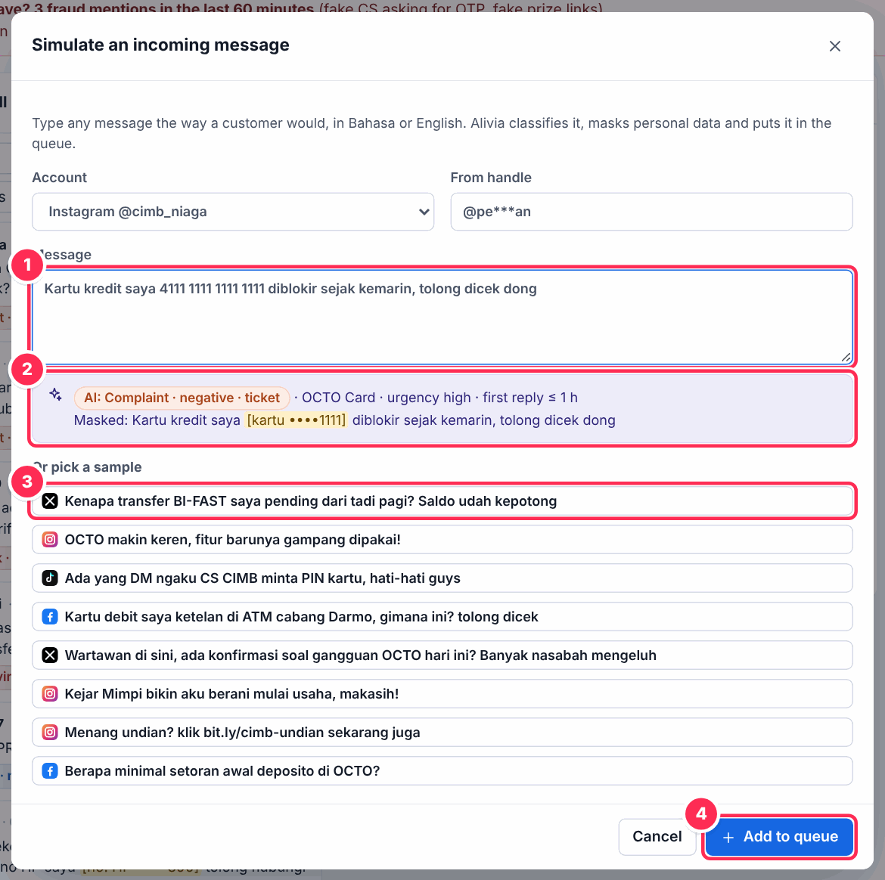

1. Type any message, in Bahasa or English.
2. The **preview** shows how Alivia classifies it and what it masks. Here, a card number becomes `[kartu ••••1111]`.
3. Or pick one of the **sample messages**.
4. **Add to queue** puts it in the care desk.

---

## 13. Social tickets

Lume feeds CIMB Niaga's existing complaint system and Ask OCTO; it doesn't replace them. Every social complaint gets an SM- ticket with a clock for the OJK deadline: **10 working days from complete documents, plus 10 more with written notice (POJK 22/2023)**.

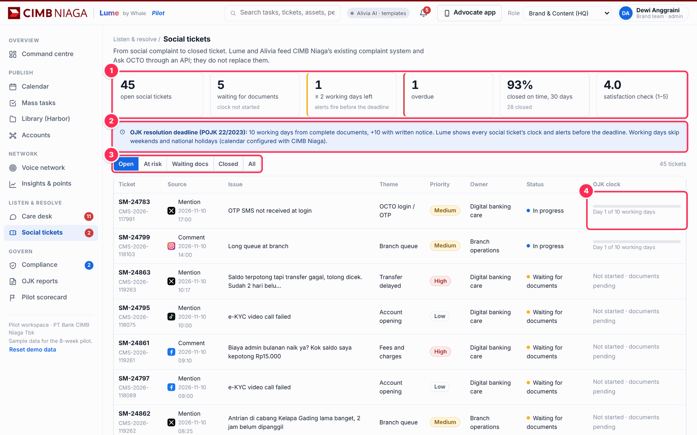

1. **Ticket numbers:**
   - open tickets
   - waiting for documents (clock not started)
   - **≤ 2 working days left** (alerts fire)
   - overdue
   - closed on time in the last 30 days
   - average satisfaction
2. The OJK rule, as a reminder.
3. **Filters:** Open, At risk, Waiting docs, Closed, All.
4. The **OJK clock** for each ticket: green on track, amber at risk, red overdue.

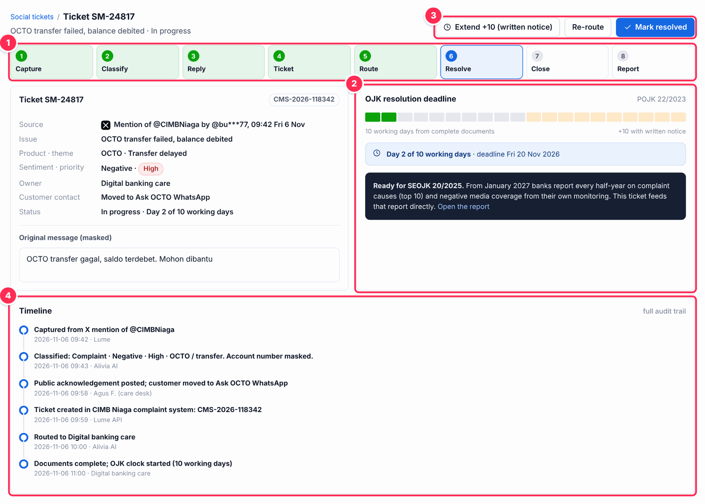

1. **The 8 steps:** Capture → Classify → Reply → Ticket → Route → Resolve → Close → Report.
2. **OJK resolution deadline.** One block per working day (10, plus 10 for an extension), with the deadline date. Weekends and national holidays don't count.
3. **Actions:**
   - **Extend +10 (written notice)**
   - **Re-route** to another team
   - **Mark resolved**, then **Close & public follow-up**
4. The **timeline** is the full audit trail of who did what and when.

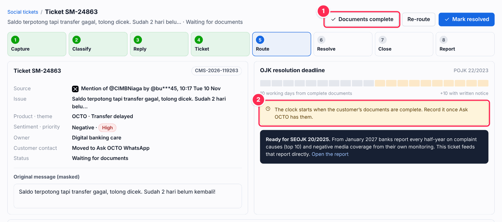

1. **Documents complete.** Click it when Ask OCTO has the customer's documents; this starts the 10-day clock.
2. Until then, the ticket shows that the clock hasn't started.

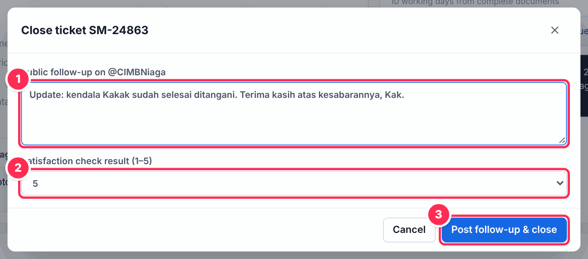

1. The **public follow-up** is posted under the customer's original comment. It's checked by AI first.
2. Record the **satisfaction check** result (1–5).
3. **Post follow-up & close.** The ticket is added to the half-year complaint report.

---

## 14. Compliance

Every post and reply is checked before it goes out. The checks follow OJK's finfluencer rule (**POJK 6/2026**) and the complaint rule (**POJK 22/2023**).

### Try the AI check

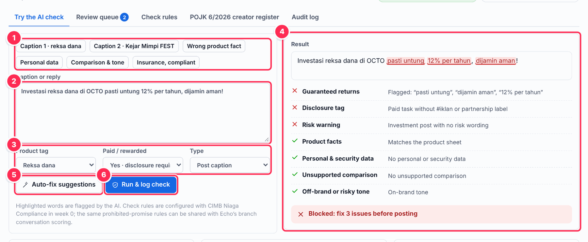

1. **Examples** to try:
   - Caption 1 (reksa dana)
   - Caption 2 (Kejar Mimpi FEST)
   - wrong product fact
   - personal data
   - comparison and tone
   - a compliant insurance post
2. Type or paste any **caption or reply**.
3. Set the **product tag**, whether it's **paid**, and whether it's a **post or a care reply**.
4. **Result.** Flagged words are underlined. Seven checks run:
   - guaranteed returns
   - disclosure tag
   - risk warning
   - product facts
   - personal and security data
   - unsupported comparison
   - off-brand or risky tone
5. **Auto-fix suggestions** rewrite the caption.
6. **Run & log check** saves the result to the audit log.

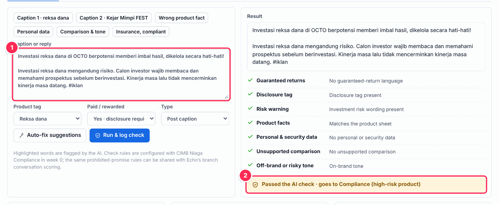

1. Auto-fix has:
   - replaced "pasti untung" and "dijamin aman"
   - removed the "12% per tahun" return claim
   - added the required investment risk wording and `#iklan`
2. Because reksa dana is a high-risk product, the verdict is **Passed the AI check · goes to Compliance**.

### Review queue, rules, creators and audit (Compliance role)

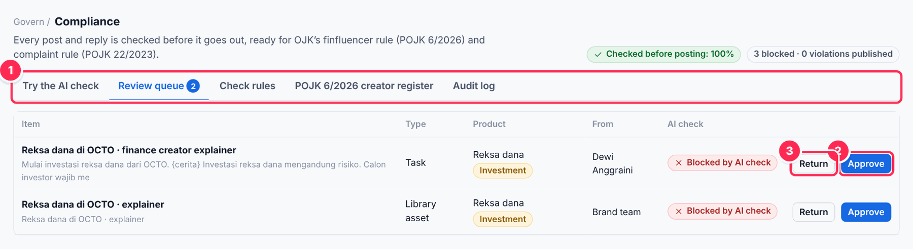

1. **Tabs:** Try the AI check, Review queue, Check rules, POJK 6/2026 creator register, Audit log.
2. **Approve** releases a task, asset or post. Approving a task pushes it to phones.
3. **Return** sends it back to the team as a draft.

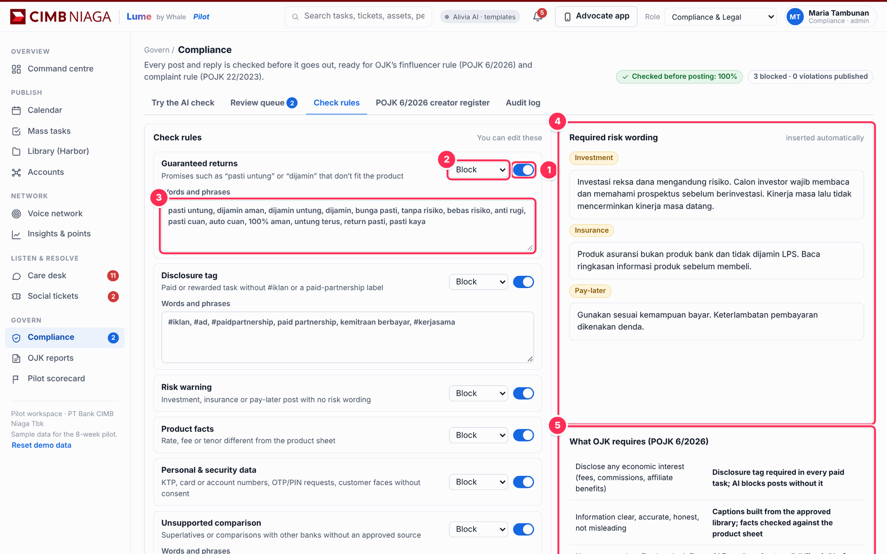

1. **Switch** a rule on or off.
2. Set the **severity**: Block, or Warn only.
3. Edit the **words and phrases** each rule looks for, separated by commas.
4. The **required risk wording** for investment, insurance and pay-later products, inserted automatically.
5. **What OJK requires** and how Lume supports each point.

Only **Compliance and Legal** can change rules. Other roles see them read-only. The rules are configured with CIMB Niaga Compliance in week 0.

1. The **alignment window**: existing influencer agreements must be aligned with POJK 6/2026 within six months of June 2026. Legal confirms the exact date.
2. **Mark aligned** once a creator's contract is updated.

The register lists every creator with their briefs, posts, disclosure status and payments, ready for audit.

1. Every check: time, source, the text checked, the result, the issues found and who ran it. Blocked items never publish.

---

## 15. OJK reports

1. **Period.** *H2 2026 · dry run* shows the format with today's data. *H1 2027 · first report* starts filling from 1 January 2027 (SEOJK 20/2025).
2. **Copy as CSV** puts the report on your clipboard for Excel or Google Sheets.
3. **Totals:**
   - social complaints logged as tickets
   - resolved and closed
   - closed within the OJK deadline
   - extended with written notice
4. The **top 10 complaint causes** from social channels, and a breakdown by channel.
5. The **negative coverage log**, from Lume's own monitoring. Crisis escalations from the care desk are added automatically.

CIMB Niaga's complaint system remains the system of record. Compliance aligns the report format before the first submission.

---

## 16. Pilot scorecard

1. **Pilot scope:**
   - all accounts in one console
   - one social care desk on X, Instagram and Facebook
   - about 300 employee advocates in 20 branches
   - about 100 KejarMimpi ambassadors
   - 5–10 creators
   - 3 campaigns
2. **The 8-week plan, from week 0 to week 8:**
   - setup
   - onboarding and baseline
   - an OCTO campaign
   - an event campaign
   - the care desk
   - always-on fraud alerts (#WaspadaSelalu)
   - the readout

   The example start is the week of 16 November 2026.
3. **How we'll know it worked.** Ten measures with their pass marks and current value, each marked *On track* or *Below mark*:
   - participation ≥ 60%
   - execution ≥ 70%
   - compliance 100% / 0
   - engagement ≥ 10×
   - reach +30%
   - tracked links 100%
   - first reply ≤ 1 h
   - ticketing 100%
   - resolution 100%
   - sentiment +5 pts
4. **The decision rule:** scale up region by region if the participation, compliance, engagement and care targets are met.

1. **Clear owners** on the CIMB Niaga side and the Whale side.
2. **Privacy by design:**
   - opt-in only
   - personal data masked
   - post-level results only
   - no customer data in posts
   - UU PDP 27/2022
   - a full audit trail

---

## 17. 10-minute demo script

Open the [Social Hub link](https://whale-alivia.stage.meetwhale.com/share/agi/artifact/5kBrYi3VWa6LnRfjRQhsH99d), sign in as `whale.admin` (password `lume2026`), then click **Reset demo data**.

| Minute | Show | Where |
|---|---|---|
| 0–1 | Today's numbers, then press **Push #WaspadaSelalu now** | Command centre |
| 1–2 | 5 accounts clash on Tuesday → **Auto-stagger** → 0 clashes | Calendar |
| 2–3 | **New post** with a risky caption → blocked → **Auto-fix** → ready | Calendar |
| 3–5 | Open **Advocate app** → Kejar Mimpi FEST task → **Buat caption dengan AI** → **Bagikan sekarang** → watch the task results update | Mass tasks + phone |
| 5–7 | Complaint from @bu***45 → **AI draft** → **Approve & post** → ticket created; then the fraud message → **Alert fraud team** | Care desk |
| 7–8 | Ticket SM-24817: steps and the OJK clock | Social tickets |
| 8–9 | Caption 1 (reksa dana) → blocked → **Auto-fix** → goes to Compliance | Compliance |
| 9–10 | Ten pass marks and the 8-week plan | Pilot scorecard |

---

## 18. Troubleshooting and FAQ

**I want to start the demo over.**
Click **Reset demo data** at the bottom of the left menu.

**I can't sign in.**
Check the user ID (for example `dewi.anggraini`, all lower case) and the password `lume2026`, and that Caps Lock is off. After 5 wrong tries, wait 30 seconds.

**I see the wrong team's menus.**
Sign out from the account menu and sign in with the account for your team.

**The page doesn't open.**
Use a current version of Chrome, Edge or Safari, and check that your network allows the link's address. Ask the Whale team if it is still blocked.

**The AI badge says "templates".**
Drafts come from the approved template library in the pilot. The compliance checks are rules, and they work the same everywhere.

**My colleague sees different data.**
Each browser keeps its own copy of the pilot workspace.

**Where is my data stored?**
In your browser's storage for the Social Hub site. Clearing the browser's site data resets it.

**Copy buttons don't work in the web page.**
Some browsers block the clipboard. Select the text and press Ctrl+C (⌘C).

---

## 19. Glossary

| Term | Meaning |
|---|---|
| **KOS** | Key opinion sales: employees who share approved content on their own accounts |
| **KOC** | Key opinion consumers: community members such as KejarMimpi members and OCTO Land or OCTO Arena regulars |
| **KOL** | Key opinion leaders: paid creators, ambassadors and partners |
| **BGC / PGC / UGC / SGC** | Brand-, creator-, community- and staff-generated content |
| **Harbor** | Whale's content and asset library |
| **Alivia** | Whale's AI that listens, sorts, drafts and runs workflows |
| **Echo** | Whale's branch-conversation insight; the source of "What customers ask in branches" |
| **SM- ticket** | A social-media complaint ticket created by Lume in CIMB Niaga's complaint system |
| **Ask OCTO** | CIMB Niaga's customer-care channel (app and WhatsApp +62 811-9781-4041) |
| **#iklan** | The disclosure tag for paid or rewarded posts |
| **POJK 6/2026** | OJK regulation on financial information conveyors (finfluencers) |
| **POJK 22/2023** | OJK regulation on consumer protection: complaints resolved within 10 working days of complete documents, plus 10 with written notice |
| **SEOJK 20/2025** | OJK circular: half-year complaint reports, including the top 10 causes and negative media coverage, from January 2027 |
| **#WaspadaSelalu** | CIMB Niaga's official fraud-awareness campaign |
| **Tracked link** | A `cimb.id` link with the advocate's reference, used to attribute clicks and OCTO sign-ups |

---

*Lume for CIMB Niaga, pilot workspace. Regulation summaries are for guidance only; CIMB Niaga Compliance and Legal confirm how each rule applies.*
